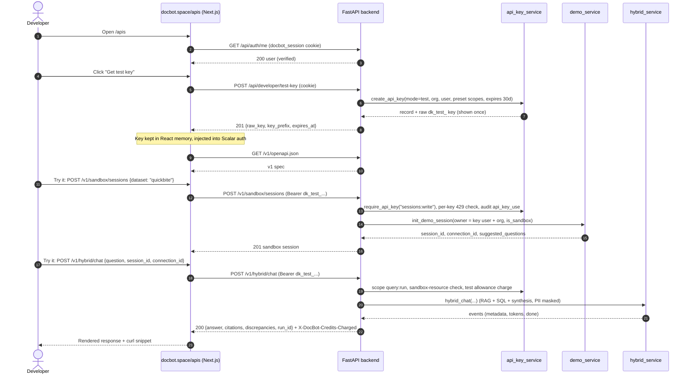

# Public API and Developer Portal Plan (docbot.space/apis)

Sources: `api/api_key_service.py`, `api/index.py`, `api/demo_service.py`, `api/credit_service.py`, `api/billing_models.py`, `api/utils/request_guard.py`, `api/utils/security_headers.py`, `api/resource_scope_service.py`, `api/routes/*.py`, `next.config.ts`, `src/app/**`, `tests/unit/test_route_guards.py`, `project-tasks/docbot-master-backlog.md` (EPIC-39, DOCBOT-2907), `project-tasks/docbot-enterprise-roadmap.md`

Last verified against code: 2026-11-23

Status: **PROPOSAL**. Nothing on this page is built yet except where it says "exists". Current behavior is in [Developer API: Current State](api-01-current-state).

## 1. Goal and non-goals

Goal: a signed-in DocBot user opens `docbot.space/apis`, gets a personal **test key** in one click, reads the docs, and runs real requests against a **safe sandbox dataset** from the page. When they are ready, an org admin issues a **live key** that hits the org's real documents and databases, billed in credits, rate limited, and audited.

Non-goals for v1:

- No DB connection management over the API (SSRF and credential handling stay in the UI until reviewed separately).
- No arbitrary code execution (`/api/sandbox/execute`) over the API.
- No admin, billing, auth or user-management surface over the API. Keys never mint keys.
- No SDKs, webhooks or MCP server yet. Those are EPIC-39 follow-ons (DOCBOT-3903/3904/3906/3907).

## 2. Design summary

| Topic | Decision |
|---|---|
| Base URL | `https://docbot.space/v1` (already proxied to the backend, `next.config.ts` rewrites). Backend host also works server-to-server. |
| Auth header | `Authorization: Bearer <key>` (exists). Keys in a query string or body are rejected with 400 `key_in_url`. |
| Key types | `dk_test_...` personal sandbox key, `dk_live_...` org key (existing format kept, so issued keys keep working). See section 3. |
| Scopes | Extend the existing four (section 4). `hybrid:read` kept as an alias. |
| Versioning | URL major version `/v1`. Additive changes only within v1. Breaking change means `/v2`, with 6 months of overlap, `Deprecation` and `Sunset` headers on v1. |
| Error envelope | One JSON shape for every `/v1` error (section 6). |
| Idempotency | `Idempotency-Key` header on all cost-bearing POSTs, 24h replay window (section 7). |
| Pagination | Cursor: `?limit=&starting_after=`, response `{data, has_more, next_cursor}` (section 8). |
| Streaming | JSON by default (exists). Opt in with `Accept: text/event-stream` (section 9). |
| Rate limits | Per key, shared counter store, 429 with `Retry-After` and `X-RateLimit-*` headers (section 10). |
| Metering | Credits per call, attributed to `api_key_id`; test keys draw from a separate daily allowance (section 11). |
| Spec | Generated from the FastAPI app, filtered to `/v1`, served at `GET /v1/openapi.json`, snapshot-tested in CI (section 12). |
| Playground | Scalar API Reference, bundled from npm, rendered by Next.js at `/apis` behind login (section 13). |
| Code location | `api/routes/v1_routes.py` (+ `v1_*_routes.py` if it grows), models in `api/v1_models.py`, Zod mirror `src/lib/schemas/v1.ts` (CLAUDE.md F-4). Existing `/v1` handlers move out of `api/index.py` in DOCBOT-3901. |

## 3. Key types

| | Test key `dk_test_` | Live key `dk_live_` (exists) |
|---|---|---|
| Who mints | Any signed-in, email-verified user, for themselves, from `/apis` | Org admin, from `/chat` > Admin > API Keys (exists) or `/apis` |
| Bound to | `org_id` **and** `user_id` (new `created_by` column) | `org_id` (exists) + `created_by` |
| Data it can touch | Only sandbox sessions it created via `POST /v1/sandbox/sessions` (demo datasets `quickbite`, `fuel`, `tieout` from `api/demo_service.py`) | Any user-owned session/connection in the org (exists, `v1_resources_in_org`) |
| Can upload | No | Yes (`POST /v1/documents`, phase 3) |
| Billing | Free daily allowance per user (default 300 credits/day), never debits the org balance | Org credit balance (exists, DOCBOT-2330) |
| Rate limit | 10 req/min, 1 concurrent long run | 60 req/min, 3 concurrent long runs (tunable per org later) |
| Expiry | 30 days, renewable in one click | Optional, admin-chosen (default none, max 1 year) per DOCBOT-2907 |
| Max per principal | 2 active per user | 25 active per org |

Why keep `dk_` and not `dbk_`: existing `dk_live_` keys are already issued and hashed; renaming would force rotation for no security gain. The `_test_`/`_live_` infix is what matters (it makes the mode visible in logs and secret scanners).

Mode enforcement: `require_api_key` resolves the key record, sets `request.state.key_mode`. A small helper `require_sandbox_resource()` rejects a test key that references a non-sandbox `session_id` or `connection_id` with 404 (same "not found" as cross-org, no existence oracle). Sandbox sessions get `sessions.is_sandbox = true` and `user_id = key.created_by`, which also satisfies the existing `session_in_org` rule (`api/resource_scope_service.py:19-42`) without loosening it for anonymous demo rows.

## 4. Scopes

| Scope | Grants | Role equivalent | Test keys get |
|---|---|---|---|
| `sessions:read` | List/get sessions, list connections, read schema, personas | viewer | yes |
| `sessions:write` | Create sandbox sessions, upload documents, delete sessions | analyst | yes (sandbox only) |
| `query:run` | `/v1/chat`, `/v1/db/query`, `/v1/hybrid/chat` | viewer | yes |
| `hybrid:read` | Alias of `query:run` limited to `/v1/hybrid/chat` (exists, kept for issued keys) | viewer | no |
| `autopilot:run` | `/v1/autopilot/run` (exists) | analyst | yes |
| `lineage:read` | Lineage JSON and tie-out workpaper download (exists, extended) | viewer | yes |
| `usage:read` | `/v1/usage` for this key, `/v1/me` always allowed | viewer | yes |
| `connectors:manage` | Commerce connectors (exists). **Hidden from the spec and portal until NEW-01 fixes org scoping** | analyst | no |

The existing rule "exact set membership, no hierarchy inference" (`api/api_key_service.py:52-55`) stays. The portal presets a test key with every "yes" scope.

## 5. Sandbox / demo mode

Reuse `init_demo_session()` (`api/demo_service.py:604`), which already builds a vector store, a session row, a SQLite DB, a `db_connections` row and a schema cache, and returns `session_id`, `connection_id`, `suggested_questions` (`api/demo_service.py:700-711`). The `/v1/sandbox/sessions` handler calls it with `owner` set to the key's `(user_id, org_id)` and marks the session `is_sandbox`. Demo data includes deliberate discrepancies, so the hybrid and tie-out features show their value on the first call.

Abuse controls reused: `check_demo_init_limit` style windows (`api/utils/request_guard.py:478-501`) keyed on the user, the `DEMO_DAILY_USD_CAP` breaker (`:445-475`), and the platform spend cap. Sandbox sessions expire after 24h (cleanup job, inferred to fit the existing session TTL sweep).

## 6. Error envelope

Every `/v1` error, including 401/403 from `require_api_key`, validation 422s and 402/429 quota errors:

```json
{
  "error": {
    "type": "invalid_request_error",
    "code": "missing_scope",
    "message": "API key missing required scope: autopilot:run.",
    "param": null,
    "request_id": "req_7f3c2a9e",
    "doc_url": "https://docbot.space/apis#errors-missing_scope"
  }
}
```

| HTTP | `type` | `code` values |
|---|---|---|
| 400 | `invalid_request_error` | `invalid_body`, `key_in_url`, `unsupported_dataset`, `idempotency_key_reused` |
| 401 | `authentication_error` | `missing_key`, `invalid_key`, `revoked_key`, `expired_key` |
| 402 | `billing_error` | `insufficient_credits`, `account_frozen` (existing `QuotaErrorCode`, `api/billing_models.py:115-121`) |
| 403 | `permission_error` | `missing_scope`, `test_key_not_allowed`, `email_unverified` |
| 404 | `not_found_error` | `resource_not_found` (also used for cross-org and cross-mode access) |
| 409 | `conflict_error` | `idempotency_in_progress` |
| 413 | `invalid_request_error` | `payload_too_large` |
| 422 | `invalid_request_error` | `validation_failed` (`param` = first failing field) |
| 429 | `rate_limit_error` | `rate_limited`, `test_allowance_exhausted`, `concurrency_limited` |
| 502 | `upstream_error` | `pipeline_failed` (existing `"An internal error occurred."` path) |
| 503 | `service_unavailable` | `platform_capacity`, `maintenance` (write freeze) |

Implementation: one exception handler registered for paths starting with `/v1/` that maps `HTTPException.detail` (string or `QuotaErrorPayload`) into this envelope. `/api/*` keeps `{"detail": ...}` so the frontend is untouched. Every response carries `X-Request-Id`.

## 7. Idempotency

`Idempotency-Key: <client uuid>` on `POST /v1/sandbox/sessions`, `/v1/documents`, `/v1/chat`, `/v1/db/query`, `/v1/hybrid/chat`, `/v1/autopilot/run`. Stored as `(api_key_id, idem_key) -> {request_hash, status, response_json, created_at}` for 24h. Same key + same body returns the stored response with `Idempotent-Replayed: true` and no new charge. Same key + different body returns 400 `idempotency_key_reused`. A request still running returns 409 `idempotency_in_progress`. Optional (not required) in v1, because LLM answers are not deterministic and clients should be able to re-ask.

## 8. Pagination

List endpoints (`/v1/sessions`, `/v1/db/connections`, `/v1/usage`) accept `limit` (1-100, default 20) and `starting_after` (opaque cursor). Response:

```json
{"data": [ ... ], "has_more": true, "next_cursor": "cur_..."}
```

Order is newest first. Cursor encodes `(created_at, id)` to stay stable under inserts.

## 9. Streaming (SSE) contract

Default stays buffered JSON (the existing rationale in `api/index.py:3580-3600` is right for scripts). Clients that want tokens send `Accept: text/event-stream`. The server re-emits the internal pipeline stream with **named events** and a stable schema (the internal `{"type": ...}` payloads are not a public contract):

```
event: metadata
data: {"intent":"hybrid","has_sql":true,"has_docs":true}

event: token
data: {"text":"Q4 net income was "}

event: step            (autopilot only)
data: {"index":1,"tool":"sql_query","status":"done","summary":"..."}

event: done
data: {"run_id":"...","trace_id":"...","citations":[...],"usage":{"credits":37}}

event: error
data: {"error":{"type":"upstream_error","code":"pipeline_failed","message":"..."}}
```

Rules: exactly one terminal `done` or `error`; a `: ping` comment every 15s; PII masking is applied before emit (the hybrid path already masks per token, `api/hybrid_service.py:864-882`); credits are settled after `done` even if the client disconnects.

## 10. Rate limits

Replace the in-memory sleeping bucket (`api/api_key_service.py:129-132`, `:400-401`) with `request_guard._charge()` against the shared counter store (`api/utils/request_guard.py:254`, Postgres-backed store at `:215`), keyed by `api_key_id`:

| Limit | Test | Live |
|---|---|---|
| Requests per minute | 10 | 60 |
| Concurrent long runs (autopilot, streaming) | 1 | 3 |
| Sandbox sessions per hour | 5 | n/a |

Every `/v1` response includes `X-RateLimit-Limit`, `X-RateLimit-Remaining`, `X-RateLimit-Reset`. A 429 includes `Retry-After`. The existing per-IP limiter (`api/index.py:101-119`) stays as a backstop. Note: through Vercel all calls may appear from few IPs (inferred), which is another reason per-key limits must be primary.

## 11. Credit metering per key

- Live keys: unchanged reservation and settlement against the org (`api/credit_service.py`, `_begin_v1_billing` at `api/index.py:3625-3636`), plus `api_key_id` written onto the usage event / ledger metadata so `/v1/usage` and the portal can show spend per key.
- Test keys: no org debit. A per-user daily counter (`test_credits`, default 300) is charged with the same `cost_to_credits()` result; when exhausted, 429 `test_allowance_exhausted`. This makes "play" free for the user and bounded for us (300 credits = $0.30 retail per user per day).
- Responses carry `X-DocBot-Credits-Charged` (live and test) so the playground can show cost per call.

## 12. OpenAPI generation

- Disable the public defaults in production: `FastAPI(docs_url=None, redoc_url=None, openapi_url=None)` unless `ENV=dev` (NEW-02). Today they are open on the backend host (`api/index.py:50`).
- Serve `GET /v1/openapi.json`, built with `fastapi.openapi.utils.get_openapi(routes=[r for r in app.routes if r.path.startswith("/v1/") and "v1" in r.tags])`, with `securitySchemes: {bearerAuth: {type: http, scheme: bearer}}`, servers `https://docbot.space`. Public is fine: it only describes the public surface.
- Response models are Pydantic in `api/v1_models.py` so the spec is typed (the current `/v1` handlers return bare dicts, so their spec responses are empty today, inferred from missing `response_model`).
- CI: `tests/unit/test_v1_openapi_snapshot.py` diffs the generated spec against `api/openapi/v1.json`; a breaking diff (removed field, new required field) fails unless the version bumps.

## 13. Playground choice

| Option | Try-it | Fit with Next.js + nonce CSP (`src/proxy.ts`) | Auth prefill | Look and size | Verdict |
|---|---|---|---|---|---|
| **Scalar API Reference** (`@scalar/api-reference-react`, MIT) | Yes, built in, with generated curl/Python/JS snippets | React component, bundle from npm, no CDN; needs `style-src` for its injected styles (verify against nonce CSP) | Yes, bearer token can be preset in config | Modern, readable, one page | **Recommended** |
| Swagger UI (`swagger-ui-react`, Apache-2.0) | Yes | Works, heavier bundle, dated styling | Yes (`preauthorizeApiKey`) | Familiar to every dev, but looks generic | Fallback |
| Redoc (MIT) | No (try-it is Redocly paid) | Easy | n/a | Best for reading only | Reject for a playground |

Recommendation: Scalar. It gives docs and a working "Try it" in one component, matches a premium product feel, and has no server component. Concrete setup:

- Page `src/app/apis/page.tsx` (client component inside a server layout). Server layout calls `/api/auth/me` with the cookie; not signed in redirects to `/signup?next=/apis`. Public visitors see a short landing with "Sign in to get a test key" and a static read-only copy of the reference (no try-it).
- Spec source: `/v1/openapi.json` (same origin).
- Test key: the page calls a session-cookie route `POST /api/developer/test-key` (new, `api/routes/developer_routes.py`) that returns the raw test key once; it is held **in React memory only** and passed to Scalar's auth config. Scalar's own auth persistence must be disabled (verify option; if it cannot be disabled, clear its `localStorage` entry on unload). Never put the key in the URL.
- "Try it" requests go to `https://docbot.space/v1/...`, same origin, so the existing CORS `allow_headers=["Content-Type"]` does not need to change.
- Quickstart block above the reference: three curl calls (create sandbox session, ask a hybrid question, fetch lineage) prefilled with the in-memory key (DOCBOT-3905 acceptance: first answer in under 10 minutes).

## 14. Security

| Control | Plan |
|---|---|
| Key never in URL | 400 `key_in_url` if `api_key`, `key`, `token` or a `dk_` value appears in the query string; access logs strip query strings on `/v1` (inferred need). |
| Storage | SHA-256 of a 256-bit random key (exists) is adequate; no slow hash needed for high-entropy keys. Add `expires_at`, `created_by`, `mode`. |
| CORS | Unchanged. `/v1` is for server-to-server use and same-origin playground. Do not add `Authorization` to `allow_headers`. |
| Tenant isolation | Every `/v1` handler resolves resources through `resource_scope_service` with the key's org (exists for hybrid/autopilot/lineage). Fix `/v1/connectors*` first (NEW-01). Add a cross-org test per route. |
| SSRF | No DB connect over `/v1` in v1. When added later, it must call the same validator and DNS pinning as `POST /api/db/connect` (DOCBOT-1608), never a copy. |
| PII masking | Responses go through the same pipelines that mask today (hybrid token masker, sandbox stdout masker `api/index.py:2240-2242`, autopilot references masking). Add a `/v1` contract test that a seeded email/SSN in sandbox data comes back masked. |
| Audit | `api_key_use` event per call exists (`api/api_key_service.py:406-419`). Add key mint/revoke/expire events and `key_mode` in metadata. |
| Docs exposure | Close default `/docs`, `/redoc`, `/openapi.json` in prod (NEW-02). |
| Leaked key response | Revoke in one click from `/apis` and the admin panel (exists); add GitHub secret-scanning partner registration for the `dk_live_` pattern later. |

## 15. Rollout phases

| Phase | Ships | Exit check |
|---|---|---|
| 0. Fix what exists (1 sprint) | NEW-01 org-scope `/v1/connectors*`, NEW-02 close default docs, NEW-12 fix buffered hybrid answer | Cross-org test green; `/docs` 404 on prod backend |
| 1. Contract (1 sprint) | DOCBOT-3901: move `/v1` to `api/routes/v1_routes.py`, `api/v1_models.py` + Zod, error envelope, per-key 429 limiter, `/v1/openapi.json`, `/v1/me` | Spec snapshot test; 429 test; envelope test |
| 2. Play (1 sprint) | DOCBOT-2907 test keys + expiry, NEW-03 sandbox sessions, NEW-04 self-serve test key, DOCBOT-3905 `/apis` page with Scalar | A new signed-up user gets a first hybrid answer from `/apis` in under 10 minutes |
| 3. Build for real (1-2 sprints) | NEW-05 sessions endpoints, NEW-06 chat + db query, NEW-07 document upload, NEW-08 usage, NEW-09 idempotency, NEW-10 streaming, NEW-11 tie-out download | Live key integration test against a real org in staging |
| 4. Ecosystem (later) | DOCBOT-3902 async jobs, 3903 webhooks, 3904 MCP, 3906/3907 SDKs, connectors back in the spec | Per EPIC-39 |

## 16. Sequence: developer gets a key and tries an endpoint



## 17. Endpoint decisions (every existing backend route)

Legend: **v1** = exposed in v1 (as the `/v1` path shown), **Later** = after v1, **Never** = will not be exposed to API keys.

| Method | Current route | Decision | v1 path | Justification |
|---|---|---|---|---|
| GET | `/api/health` | Later | `/v1/health` | Nice for uptime checks, but not needed to play; status page covers it. |
| GET | `/api/personas` | v1 | `/v1/personas` | Callers must know valid `persona` values; static and cheap. |
| GET | `/api/tools` | Later | | Internal tool-picker metadata; no API use case yet. |
| POST | `/api/demo/init` | v1 | `/v1/sandbox/sessions` | The safe-play foundation; wrapped with key ownership and `is_sandbox`. |
| POST | `/api/upload` | v1 (phase 3, live only) | `/v1/documents` | Without upload, live keys can only use UI-created sessions. |
| POST | `/api/chat` | v1 | `/v1/chat` | Doc-only Q&A is the simplest useful call. |
| GET | `/api/sessions` | v1 | `/v1/sessions` | Discover `session_id`s instead of copying from the UI. |
| GET | `/api/session/{session_id}` | v1 | `/v1/sessions/{id}` | Read files and message history for a session. |
| DELETE | `/api/session/{session_id}` | v1 | `/v1/sessions/{id}` | Clients must be able to clean up what they create (data retention). |
| GET | `/api/export/{session_id}` | Later | | Export format is UI-oriented; revisit with workpaper API. |
| POST | `/api/session/{session_id}/update-persona` | Never | | Persona is a per-request field in `/v1`; no session mutation needed. |
| POST | `/api/test-persona-switch` | Never | | Dev-only debug route (404 outside dev). |
| GET | `/api/test-personas` | Never | | Dev-only debug route. |
| POST | `/api/db/connect` | Later | | SSRF + credential intake over API needs its own security review; connect in UI for v1. |
| DELETE | `/api/db/disconnect/{connection_id}` | Later | | Pairs with connect. |
| GET | `/api/db/schema/{connection_id}` | v1 | `/v1/db/connections/{id}/schema` | Callers need table names to ask good questions. |
| POST | `/api/db/refresh-schema/{connection_id}` | Later | | Drift retry is automatic in the pipeline. |
| POST | `/api/db/chat` | v1 | `/v1/db/query` | NL to SQL over a connected DB is a core product capability. |
| GET | `/api/db/sessions` | v1 | `/v1/db/connections` | Discover `connection_id`s. |
| GET | `/api/db/history/{connection_id}` | Later | | Query history is a UI convenience. |
| POST | `/api/db/upload` | Later | | SQLite file parsing over the API widens attack surface; low demand. |
| POST | `/api/db/upload/csv` | Later | | Valuable for CFO users; add after `/v1/documents` proves out. |
| POST | `/api/sandbox/execute` | Never | | Arbitrary code execution via API key is an abuse and cost magnet; pipelines already use E2B internally. |
| GET | `/api/artifacts/{session_id}` | Later | | Charts/code artifacts; useful once streaming lands. |
| GET | `/api/artifacts/item/{artifact_id}` | Later | | Same as above. |
| GET | `/api/lineage/{run_id}` | v1 (exists) | `/v1/lineage/{run_id}` | Provenance is the product's trust story. |
| POST | `/api/traces/{trace_id}/feedback` | Later | | Thumbs-up/down from integrations is nice, not core. |
| POST | `/api/hybrid/chat` | v1 (exists) | `/v1/hybrid/chat` | The core differentiator (docs + DB + discrepancies). |
| POST | `/api/autopilot/run` | v1 (exists) | `/v1/autopilot/run` | Multi-step analysis; becomes async job in DOCBOT-3902. |
| GET | `/api/auth/saml/metadata` | Never | | IdP-facing browser SSO. |
| GET | `/api/auth/saml/login` | Never | | Browser SSO redirect. |
| POST | `/api/auth/saml/acs` | Never | | IdP assertion endpoint. |
| GET | `/api/auth/debug-urls` | Never | | Dev-only. |
| GET | `/api/auth/config` | Never | | Login-screen metadata. |
| POST | `/api/auth/owner-unlock` | Never | | Owner bypass; must never be key-reachable. |
| GET | `/api/auth/github` | Never | | Browser OAuth. |
| GET | `/api/auth/github/callback` | Never | | Browser OAuth. |
| GET | `/api/auth/google` | Never | | Browser OAuth. |
| GET | `/api/auth/google/callback` | Never | | Browser OAuth. |
| POST | `/api/auth/register` | Never | | Account creation is human-only (Turnstile, verification). |
| POST | `/api/auth/login` | Never | | Password login is human-only. |
| GET | `/api/auth/me` | Never | replaced by `/v1/me` | Keys are not users; `/v1/me` describes the key instead. |
| POST | `/api/auth/logout` | Never | | Cookie-only concept. |
| GET | `/api/auth/workspace` | Never | | UI bootstrap data. |
| POST | `/api/auth/verify` | Never | | Email token flow. |
| POST | `/api/auth/onboarding` | Never | | UI onboarding. |
| GET | `/admin/audit-log` | Later | `/v1/audit-log` | Enterprise SIEM export is a real ask; needs an `audit:read` scope and admin-minted keys only. |
| GET | `/admin/users` | Never | | Privilege surface; keys must not enumerate people. |
| PATCH | `/admin/users/{user_id}/role` | Never | | Privilege escalation surface. |
| GET | `/admin/api-keys` | Never | | Keys must not manage keys; portal uses the session. |
| POST | `/admin/api-keys` | Never | | Same. |
| DELETE | `/admin/api-keys/{key_id}` | Never | | Same (a leaked key must not revoke the admin's other keys). |
| GET | `/admin/metrics` | Never | | Platform-operator, cross-org. |
| GET | `/admin/funnel` | Never | | Platform-operator, cross-org. |
| POST | `/api/connectors/register` | Later | `/v1/connectors` | Exists as `/v1` but unscoped; re-expose after NEW-01. |
| GET | `/api/connectors` | Later | `/v1/connectors` | Same. |
| GET | `/api/connectors/types` | Later | `/v1/connectors/types` | Same. |
| DELETE | `/api/connectors/{connector_id}` | Later | | Same. |
| POST | `/api/connectors/{connector_id}/orders` | Later | | Same. |
| POST | `/api/connectors/{connector_id}/financials` | Later | | Same. |
| POST | `/api/connectors/{connector_id}/sync` | Later | `/v1/connectors/{id}/sync` | Same. |
| GET | `/api/commerce/{connector_id}/orders` | Later | | Same. |
| GET | `/api/commerce/{connector_id}/financials` | Later | | Same. |
| POST | `/api/marketplace/webhook/shopify` | Never | | Inbound server-to-server webhook, HMAC-authenticated. |
| GET | `/api/billing/packs` | Never | | Purchase flow is browser + Stripe. |
| POST | `/api/billing/checkout` | Never | | Same. |
| POST | `/api/billing/webhook` | Never | | Stripe inbound. |
| POST | `/admin/credits/grant` | Never | | Money-granting operator action. |
| POST | `/api/waitlist` | Never | | Marketing form. |
| GET | `/api/admin/waitlist` | Never | | Operator data. |
| GET | `/api/lineage/{run_id}/tieout.{fmt}` | v1 | `/v1/lineage/{run_id}/tieout.{xlsx,pdf}` | The workpaper is the deliverable fractional CFOs want in their own tools. |
| POST | `/api/edgar/search` | Later | | Currently unmetered (KNOWN_UNGUARDED, DOCBOT-1623); meter first. |
| POST | `/api/edgar/filings` | Later | | Same. |
| POST | `/api/edgar/ingest` | Later | | Ingest cost; pairs with `/v1/documents`. |
| POST | `/api/edgar/ingest-batch` | Later | | Batch cost; after async jobs (DOCBOT-3902). |
| GET | `/api/edgar/cache` | Never | | Internal cache view. |
| POST | `/v1/hybrid/chat` | v1 (exists) | same | Kept; response gains `discrepancies` field, envelope, limits. |
| POST | `/v1/autopilot/run` | v1 (exists) | same | Kept. |
| GET | `/v1/lineage/{run_id}` | v1 (exists) | same | Kept. |
| GET | `/v1/connectors` | Later (hide now) | same | Cross-org listing bug (`api/index.py:3912-3913`). |
| POST | `/v1/connectors` | Later (hide now) | same | Saves without `org_id` (`api/index.py:3954`). |
| POST | `/v1/connectors/{id}/sync` | Later (hide now) | same | No org check (`api/index.py:3445-3451`). |
| (new) | | v1 | `GET /v1/me` | Key introspection: org, mode, scopes, limits, expiry. |
| (new) | | v1 | `GET /v1/usage` | Per-key credits; required for trust in metering. |
| (new) | | v1 | `GET /v1/openapi.json` | The spec the playground and SDKs consume. |
