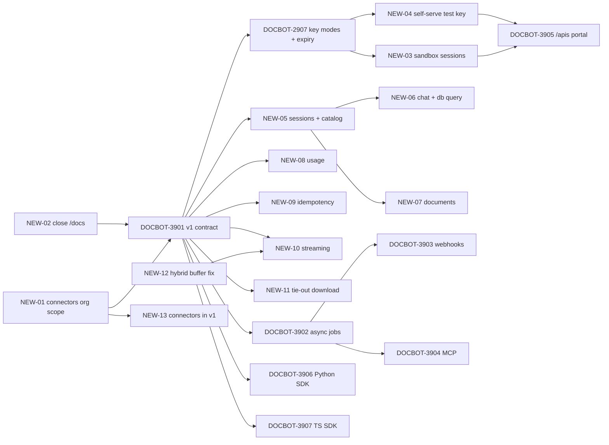

# Public API Implementation Backlog

Sources: `project-tasks/docbot-master-backlog.md` (EPIC-39 section 7.13, DOCBOT-2907, DOCBOT-3305), `project-tasks/docbot-enterprise-roadmap.md` (EPIC-39), `CLAUDE.md` (F-4 route rule, testing rules), [Developer API: Current State](api-01-current-state), [Public API and Developer Portal Plan](api-02-public-api-plan), [DocBot API v1 Reference (Proposed)](api-03-public-api-reference)

Last verified against code: 2026-11-23

## How this maps to existing tickets

EPIC-39 "API, SDK and MCP Server" already exists (7 stories, 30 pts, parked, track E; master backlog section 7.13), building on DOCBOT-1530 (developer API, shipped) and DOCBOT-2907 (scoped keys with expiry, parked). This plan reuses those ids and adds `NEW-xx` placeholders only where no ticket fits. Assign real ids from the next free DOCBOT range when filing.

Repo rules every story inherits (from `CLAUDE.md`):

- New routes in `api/routes/<area>_routes.py` as `APIRouter`; `api/index.py` only gets `app.include_router(...)`.
- Request/response models in `api/<area>_models.py` (here `api/v1_models.py`, `api/developer_models.py`) with Zod mirrors in `src/lib/schemas/<area>.ts` (identical field names).
- Every route has an auth guard (`require_api_key(...)` for `/v1`, `require_role`/`require_principal` for `/api`) or is listed in `PUBLIC_ROUTES` in `tests/unit/test_route_guards.py` with a justification.
- Tests in `tests/unit/` (no network) or `tests/integration/`; no `type: ignore`, no bare `except`, no `any` in TS.
- `copy_ctx_run()` for any executor call so principal and meter propagate (`api/utils/billing_context.py`).

## Stories

| Id | Title | Acceptance criteria | Pts | Deps | Sprint |
|---|---|---|---|---|---|
| **NEW-01** | Org-scope `/v1/connectors*` (P0 security) | `GET /v1/connectors` passes `org_id=key.org_id`; `POST` saves with `org_id`; `sync` uses `connector_in_org` like `api/routes/connector_routes.py:69-86`; cross-org test per route returns 404; routes hidden from spec until done | 2 | 1530, 1602 | S1 |
| **NEW-02** | Close default FastAPI docs in prod | `docs_url`/`redoc_url`/`openapi_url` are `None` unless `ENV=dev`; `/docs` 404 on prod backend; CSP exemption in `api/utils/security_headers.py:39` removed or dev-only; test asserts both modes | 1 | none | S1 |
| **NEW-12** | Fix buffered `/v1/hybrid/chat` answer | Honor `replace` event (answer equals corrected text); merge `metadata` events so `intent`/`has_sql`/`has_docs` are never overwritten by the SQL metadata event; unit test feeds a fake stream with both cases | 1 | none | S1 |
| **DOCBOT-3901** | Public API v1 contract (existing, expanded) | `/v1` handlers moved from `api/index.py:3580-3981` to `api/routes/v1_routes.py`; models in `api/v1_models.py` + `src/lib/schemas/v1.ts`; `response_model` on every route; `/v1` error envelope handler + `X-Request-Id`; per-key limiter on the shared counter store returns 429 + `Retry-After` + `X-RateLimit-*` (replaces sleeping in-memory bucket `api/api_key_service.py:129-132`); `GET /v1/openapi.json` filtered spec + snapshot test; `GET /v1/me`; versioning and deprecation policy doc; reject keys in query string (400 `key_in_url`) | 5 | NEW-01, NEW-02 | S1-S2 |
| **DOCBOT-2907** | Key modes, expiry, owner (existing, expanded) | `api_keys` gains `mode` (`test`/`live`), `expires_at`, `created_by`; `create_api_key(mode=...)` emits `dk_test_` or `dk_live_`; expired key -> 401 `expired_key`; existing rows backfill `mode=live`; audit events for mint/revoke/expire; scope set extended (`sessions:read`, `sessions:write`, `query:run`, `usage:read`; `hybrid:read` kept as alias); service-account part of 2907 stays as written | 3 | 3901 | S2 |
| **NEW-03** | Sandbox sessions for test keys | `POST /v1/sandbox/sessions` wraps `init_demo_session` with owner = key user + org and `sessions.is_sandbox=true`; test keys get 404 on any non-sandbox session/connection; per-owner sandbox window (5/hour); daily test credit allowance (default 300) charged via `cost_to_credits`, never debits org balance, 429 `test_allowance_exhausted`; sandbox sessions purged after 24h | 5 | 2907, 3901 | S2 |
| **NEW-04** | Self-serve personal test key | `POST /api/developer/test-key` and `DELETE /api/developer/test-key/{id}` in `api/routes/developer_routes.py`, guarded by signed-in + email-verified user (viewer+); returns raw key once; max 2 active per user; preset scopes; 30-day expiry; models in `api/developer_models.py` + `src/lib/schemas/developer.ts` | 2 | 2907 | S2 |
| **DOCBOT-3905** | Developer portal `/apis` with Scalar (existing, expanded) | `src/app/apis/page.tsx` renders Scalar from `/v1/openapi.json`; signed-out visitors see read-only docs + sign-in CTA; signed-in users click "Get test key", key held in memory only (no URL, no persisted storage), injected as bearer auth; "Try it" works same-origin through the Vercel `/v1` rewrite; quickstart (sandbox session -> hybrid question -> lineage) gives a first answer in under 10 minutes; works with nonce CSP from `src/proxy.ts`; page passes WCAG 2.1 AA basics; light/dark | 5 | 3901, NEW-03, NEW-04 | S2 |
| **NEW-05** | Session read/delete + catalog endpoints | `GET /v1/sessions`, `GET/DELETE /v1/sessions/{id}`, `GET /v1/db/connections`, `GET /v1/db/connections/{id}/schema`, `GET /v1/personas`; cursor pagination; all scoped by key org (and sandbox for test keys); cross-org and cross-mode tests | 3 | 3901, 2907 | S3 |
| **NEW-06** | `/v1/chat` and `/v1/db/query` | Buffered wrappers over `/api/chat` and `/api/db/chat` pipelines with credit reservation (`chat` 20, `db_chat` 30), audit with `api_key_id`, PII masking contract test (seeded email/SSN comes back masked) | 3 | 3901, NEW-05 | S3 |
| **NEW-07** | `/v1/documents` upload (live keys) | Multipart PDF upload reusing `/api/upload` validation and `upload_limits`; test keys 403 `test_key_not_allowed`; 413 on size; new session stamped with org and `created_by` so `session_in_org` accepts it | 3 | NEW-05 | S3 |
| **NEW-08** | Per-key usage metering | `api_key_id` recorded on usage events / ledger metadata for every `/v1` call; `GET /v1/usage` (by route + paged events); `X-DocBot-Credits-Charged` header; per-key spend visible in `/apis` and admin key list | 3 | 3901 | S3 |
| **NEW-09** | Idempotency keys | `Idempotency-Key` on cost-bearing POSTs; `(api_key_id, key)` store with request hash, 24h TTL; replay returns stored body + `Idempotent-Replayed: true` and no charge; 400 on body mismatch; 409 while in flight | 2 | 3901 | S3 |
| **NEW-10** | Opt-in SSE streaming on `/v1` | `Accept: text/event-stream` on chat, db query, hybrid, autopilot; named events `metadata`/`token`/`replace`/`step`/`done`/`error`; exactly one terminal event; 15s pings; credits settle on client disconnect; concurrency limit enforced | 3 | 3901, NEW-12 | S3 |
| **NEW-11** | `/v1` tie-out workpaper download | `GET /v1/lineage/{run_id}/tieout.{xlsx,pdf}` reusing `tieout_routes` export with the key-org `run_row_accessible` check | 1 | 3901 | S3 |
| **DOCBOT-3902** | Autopilot / tie-out as async job (existing) | As written in backlog: job result equals UI result, scoped to key; `POST /v1/jobs` + `GET /v1/jobs/{id}` | 5 | 3901, 3305 | later |
| **DOCBOT-3903** | Signed webhooks (existing) | As written: HMAC signed, retries with backoff | 3 | 3902 | later |
| **DOCBOT-3904** | MCP server (existing) | As written; reuse `/v1` scopes and test-key sandbox for MCP onboarding | 8 | 3901, 3902 | later |
| **DOCBOT-3906** | Python SDK (existing) | Generated from `/v1/openapi.json`; examples for sandbox quickstart | 3 | 3901 | later |
| **DOCBOT-3907** | TypeScript SDK (existing) | Generated from spec; Zod types from `src/lib/schemas/v1.ts` | 3 | 3901 | later |
| **NEW-13** | Re-expose connectors in v1 | After NEW-01: connectors back in the spec with `/api/connectors*` parity (types, orders, financials, delete) | 3 | NEW-01, 3901 | later |
| **NEW-14** | `/v1/audit-log` export | `audit:read` scope, live admin-minted keys only, cursor pagination, CSV option | 2 | 3901, 2907 | later |

## Totals

| Sprint | Stories | Points |
|---|---|---|
| S1 (fix and contract start) | NEW-01, NEW-02, NEW-12, DOCBOT-3901 (start) | 9 |
| S2 (play: test keys + portal) | DOCBOT-2907, NEW-03, NEW-04, DOCBOT-3905 (+ 3901 finish) | 15 |
| S3 (build for real) | NEW-05, NEW-06, NEW-07, NEW-08, NEW-09, NEW-10, NEW-11 | 18 |
| Later (EPIC-39 remainder + extras) | 3902, 3903, 3904, 3906, 3907, NEW-13, NEW-14 | 27 |
| **Total** | 22 stories | **69** |

Minimum to answer the founder's ask ("docbot.space/apis, token-gated, play with the API"): S1 + S2 = 24 points. S1 items NEW-01 and NEW-12 should ship regardless, because they fix live defects in the current `/v1` surface.

## Dependency graph

## Test plan per story (minimum)

| Story | Tests (all `tests/unit/` unless noted) |
|---|---|
| NEW-01 | `test_v1_connectors_org_scope.py`: key of org A cannot list, sync, or see org B's connector |
| NEW-02 | `test_docs_exposure.py`: `/docs`, `/redoc`, `/openapi.json` 404 when `ENV!=dev`, 200 in dev |
| NEW-12 | `test_v1_hybrid_buffer.py`: stream with `replace` -> corrected answer; two `metadata` events -> intent preserved |
| DOCBOT-3901 | `test_v1_error_envelope.py`, `test_v1_rate_limit.py` (429 + headers, shared store), `test_v1_openapi_snapshot.py`, `test_route_guards.py` stays green |
| DOCBOT-2907 | extend `test_api_key_service.py`: test/live prefix, expiry 401, backfill, alias scope |
| NEW-03 | `test_v1_sandbox.py`: test key only sees its sandbox, allowance exhaustion 429, live org balance untouched |
| NEW-04 | `test_developer_routes.py`: unverified user 403, max 2 keys, raw key returned once |
| DOCBOT-3905 | Playwright smoke (manual regression list until e2e exists): sign in, get key, run quickstart |
| NEW-06 | `test_v1_pii_masking.py`: seeded PII masked in `/v1/chat`, `/v1/db/query`, `/v1/hybrid/chat` |
| NEW-09 | `test_v1_idempotency.py`: replay, mismatch 400, in-flight 409, no double charge |
