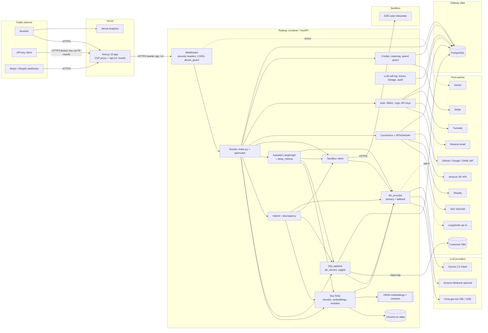

# System Overview

Sources: `api/index.py`, `api/utils/llm_provider.py`, `api/utils/embeddings_provider.py`, `api/utils/reranker.py`, `api/utils/vector_store.py`, `api/utils/sentry_setup.py`, `api/utils/langsmith_tracing.py`, `api/utils/request_guard.py`, `api/rbac_service.py`, `api/sandbox_service.py`, `api/connectors/`, `api/billing_service.py`, `api/email_verification_service.py`, `Dockerfile`, `docker-entrypoint.sh`, `railway.toml`, `vercel.json`, `next.config.ts`, `security-headers.mjs`, `src/proxy.ts`, `package.json`, `requirements.txt`

Last verified against code: 2026-11-23

## What DocBot is

DocBot is an AI analyst over three kinds of evidence: uploaded documents (PDF, SEC EDGAR filings), live or uploaded databases (PostgreSQL, MySQL, Azure SQL, SQLite, CSV), and marketplace commerce data (Shopify, Amazon SP-API). Its distinguishing path is **hybrid** answers that query documents and data in parallel, cite both, and flag numeric discrepancies (`api/hybrid_service.py`, `api/utils/discrepancy_detector.py`). Multi-step investigations run through the LangGraph **Autopilot** (`api/autopilot_service.py`).

It is two deployables:

| Deployable | Code | Host | Build |
|---|---|---|---|
| Frontend | Next.js 16 / React 19 app in `src/` | Vercel | `next build` (`vercel.json`) |
| Backend | FastAPI app `api.index:app` (Python 3.12) | Railway, one Docker container | `Dockerfile` (`railway.toml:1-3`), `uvicorn` on `$PORT` (`Dockerfile:52`) |

The frontend has no API routes of its own. It rewrites `/api/*` and `/v1/*` to the backend (`next.config.ts:36-43`), so browsers talk only to the Vercel origin.

## Components

### Backend modules (single process)

| Layer | Modules | Role |
|---|---|---|
| Entrypoint | `api/index.py` (3,981 lines) | App, middleware, SQLAlchemy `Table` registry, `lifespan` wiring, 63 route handlers |
| Routers | `api/routes/{billing,connector,email_verify,onboarding,tieout,waitlist}_routes.py` | 22 newer routes (F-4 rule) |
| Doc RAG | `api/utils/{pdf_io,chunker,embeddings_provider,vector_store,query_expansion,reranker,context_compressor,prompt_guard}.py`, `api/personas.py`, `api/utils/persona_router.py`, `api/document_extractor.py` | Ingest, retrieve, persona-routed answer (the cross-encoder reranker runs on the hybrid path only; see [AI / LLM Architecture](architecture-05-ai-llm-architecture)) |
| SQL | `api/db_service.py`, `api/utils/{sql_validator,table_selector,ssrf_validator,connection_url}.py`, `api/ontology_service.py` | 7-step bounded NL-to-SQL pipeline, engine pool, schema cache |
| Sandbox | `api/sandbox_service.py`, `api/utils/{csv_preprocessor,sandbox_policy,sandbox_paths}.py`, `api/file_upload_service.py` | CSV and Python analysis in E2B |
| Agentic | `api/hybrid_service.py`, `api/autopilot_service.py`, `api/deep_research_service.py`, `api/utils/autopilot_sources.py`, `api/tools/` | Hybrid synthesis, LangGraph Autopilot, deep retrieval |
| Connectors | `api/connectors/*`, `api/connector_store.py`, `api/commerce_service.py`, `api/edgar_service.py` | Shopify, Amazon, EDGAR; APScheduler sync |
| Identity | `api/auth_service.py`, `api/oauth_service.py`, `api/identity_service.py`, `api/email_verification_service.py`, `api/rbac_service.py`, `api/org_service.py`, `api/utils/caller_scope.py`, `api/resource_scope_service.py`, `api/api_key_service.py` | SAML, OAuth, password, sessions, roles, orgs, API keys |
| Money and abuse | `api/credit_service.py`, `api/billing_service.py`, `api/usage_service.py`, `api/utils/{billing_context,spend_guard,request_guard}.py` | Credits, Stripe, metering, rate limits, spend caps |
| Observability | `api/utils/sentry_setup.py`, `api/llm_trace_service.py`, `api/trace_service.py`, `api/lineage_service.py`, `api/metrics_service.py`, `api/funnel_service.py`, `api/eval_service.py`, `api/utils/langsmith_tracing.py` | Errors, LLM call log, agent traces, answer lineage, admin metrics |
| Compliance | `api/audit_service.py`, `api/utils/{pii_masking,encryption,envelope_encryption}.py` | Append-only audit log (immutability trigger), PII masking, Fernet + per-org envelope keys. The per-org audit hash chain (DOCBOT-2501) is on an unmerged branch, not on `main` |

### Process-local state

The backend keeps several caches in memory. They are why the service runs as a single replica (inferred from the lack of any shared cache):

| State | Where | Recovery after restart |
|---|---|---|
| `VECTOR_STORES` (LRU `SessionStoreCache`) | `api/index.py:806-807` | Warmed from Chroma on disk at startup, rest lazy-loaded (`api/index.py:732-746`) |
| `EXTRACTED_FIELDS` per session | `api/index.py:811` | Lost (inferred) |
| `app.state.connectors` live connector objects | `api/routes/connector_routes.py:62-66` | Rebuilt from `marketplace_connections` (`api/index.py:679-698`) |
| APScheduler jobs (connector sync, commerce retention, credit reaper, vector-store retention) | `api/index.py:701-772` | Re-registered at startup |
| LLM call-log and usage-event writer queues | `api/llm_trace_service.py`, `api/usage_service.py` | Drained on shutdown (`api/index.py:775-781`) |
| Per-run LLM cost accumulator | `api/utils/llm_provider.py:255-285` | Per run only |
| DB engine LRU pool | `api/db_service.py` | Recreated on demand |

Rate-limit counters are not process-local: they live in Postgres (`rate_limit_counters`, `api/index.py:603-605`, `api/utils/request_guard.py:181-193`).

## Runtime topology

| Node | Kind | Where | Used for | Evidence |
|---|---|---|---|---|
| Browser | client | user device | Next.js UI, SSE consumer | `src/lib/chatStream.ts` |
| Next.js frontend | service | Vercel | Pages, CSP nonce proxy, `/api` + `/v1` rewrite | `next.config.ts`, `src/proxy.ts` |
| Vercel Analytics | external | Vercel | Page analytics | `package.json` (`@vercel/analytics`) |
| FastAPI backend | service | Railway container (non-root `appuser`) | All business logic | `Dockerfile`, `railway.toml` |
| Railway volume `/data` | datastore | Railway | Chroma persistence (`CHROMA_DIR`), uploads | `docker-entrypoint.sh:7`, `api/utils/vector_store.py:66-69` |
| Chroma (embedded) | datastore | in-process, files on `/data` | Per-session vector collections | `api/utils/vector_store.py` |
| Local ONNX models | in-process | backend container | Embeddings `all-MiniLM-L6-v2`, reranker `ms-marco-MiniLM-L-6-v2` (fastembed) | `Dockerfile:39-41`, `api/utils/embeddings_provider.py:98`, `api/utils/reranker.py:54` |
| PostgreSQL | datastore | Railway | Every app table (see [Data Model](architecture-03-data-model)) | `api/index.py:147-168` (asyncpg) |
| Groq | external | internet | Primary LLM: `openai/gpt-oss-20b` (chat/SQL/synthesis), `openai/gpt-oss-120b` (code gen) | `api/utils/llm_provider.py:153, 671` |
| Amazon Bedrock | external | AWS | Optional primary when `LLM_PRIMARY=bedrock`, same gpt-oss models; optional `BEDROCK_FALLBACK_MODEL` | `api/utils/llm_provider.py:673-735` |
| Google Gemini | external | internet | `gemini-2.5-flash` fallback LLM and LangExtract financial extraction | `api/utils/llm_provider.py:154, 732-735`, `api/document_extractor.py` |
| E2B | external | E2B cloud | Python/pandas sandboxes (CSV queries, charts, `/api/sandbox/execute`) | `api/sandbox_service.py`, `requirements.txt:31` |
| Hugging Face Inference | external | internet | Only if `EMBEDDINGS_PROVIDER=hf` or `RERANKER_PROVIDER=hf` | `api/utils/embeddings_provider.py:98-104` |
| Customer databases | external | customer network | Read-only SQL (PostgreSQL, MySQL, Azure SQL) | `api/db_service.py` |
| SEC EDGAR | external | `www.sec.gov`, `data.sec.gov` | Company search, filing download | `api/connectors/edgar_connector.py` |
| Shopify Admin API | external | `*.myshopify.com` | Orders, financials, webhooks | `api/connectors/shopify_connector.py` |
| Amazon SP-API + LWA | external | `sellingpartnerapi-na.amazon.com`, `api.amazon.com` | Orders, finances | `api/connectors/amazon_connector.py` |
| Stripe | external | `api.stripe.com` | Credit-pack checkout + webhook | `api/billing_service.py`, `api/routes/billing_routes.py` |
| Identity providers | external | GitHub, Google, SAML IdP (Okta / Entra) | Login | `api/oauth_service.py`, `api/auth_service.py` |
| Resend | external | `api.resend.com` | Verification email (dormant without key) | `api/email_verification_service.py` |
| Cloudflare Turnstile | external | `challenges.cloudflare.com` | Sign-up bot check | `api/email_verification_service.py`, `src/components/TurnstileWidget.tsx` |
| Have I Been Pwned | external | `api.pwnedpasswords.com` | Breached-password check (k-anonymity range API, inferred) | `api/oauth_service.py` |
| Sentry | external | Sentry SaaS | Error tracking only when `SENTRY_DSN` set | `api/utils/sentry_setup.py`, `api/index.py:46-47` |
| LangSmith | external | LangSmith SaaS | Opt-in tracing only when `LANGSMITH_TRACING` and `LANGSMITH_API_KEY` both set; LangChain auto-tracing pinned off | `api/utils/langsmith_pin.py`, `api/utils/langsmith_tracing.py:78-85` |

There is no message queue or separate worker. Background work runs on the in-process `AsyncIOScheduler` and asyncio tasks (`api/index.py:701-772`).

## Trust boundaries

| Zone | Contains | Boundary controls |
|---|---|---|
| Z0 Public internet | Browser, API-key clients, webhooks (Stripe, Shopify) | CSP + security headers (`security-headers.mjs`, `src/proxy.ts`, `api/utils/security_headers.py`); CORS allow-list (`api/utils/cors_config.py`) |
| Z1 Vercel edge | Next.js, rewrite proxy | Holds no backend secrets except `BACKEND_URL` (inferred from `next.config.ts`) |
| Z2 Backend container | FastAPI, Chroma, ONNX models, scheduler | `abuse_guard` middleware (write freeze, demo block, per-IP limit), auth deps (`require_principal`, `require_role`, `require_api_key`), owner-key bypass, spend caps; non-root user (`Dockerfile:32`, `docker-entrypoint.sh`) |
| Z3 Platform data | Railway Postgres, `/data` volume | Credentials Fernet / per-org envelope encrypted (`api/utils/encryption.py`, `api/utils/envelope_encryption.py`); append-only audit log with PostgreSQL immutability trigger (`api/audit_service.py`; hash chain not yet merged) |
| Z4 LLM providers | Groq, Bedrock, Gemini, optional HF | PII masking on outputs (`api/utils/pii_masking.py`); connection strings never sent (CLAUDE.md rule; credentials stay inside `db_service`) |
| Z5 Untrusted execution | E2B sandboxes | Generated code runs remotely, not in the backend; policy and path checks in `api/utils/sandbox_policy.py`, `api/utils/sandbox_paths.py` |
| Z6 Customer and third-party systems | Customer DBs, SEC, Shopify, Amazon, Stripe, IdPs | SSRF validator with DNS pinning (`api/utils/ssrf_validator.py`, `api/utils/connection_url.py`); 3-layer read-only SQL; HMAC webhook verification |

Details: [Security Architecture](architecture-06-security-architecture).

## Component diagram

## Doc drift (CLAUDE.md vs code)

| CLAUDE.md says | Code says | Evidence |
|---|---|---|
| Chat / SQL / synthesis LLM is "Groq Llama 3.3-70b" | Default model is `openai/gpt-oss-20b`; code gen is `openai/gpt-oss-120b` | `api/utils/llm_provider.py:153, 671` |
| LLM fallback is "Groq primary, Gemini fallback" | `LLM_PRIMARY=bedrock` swaps the primary to Amazon Bedrock (same gpt-oss models or `BEDROCK_*_MODEL` overrides), and `BEDROCK_FALLBACK_MODEL` replaces Gemini as fallback | `api/utils/llm_provider.py:673-760` |
| `api/index.py` is "~1700 lines" | 3,981 lines, 63 routes still in it | `wc -l api/index.py` |
| `src/app/chat/page.tsx` is "~512 lines" | 894 lines | `wc -l src/app/chat/page.tsx` |
| Landing pages at `/` and `/landing` | `/landing` is a permanent redirect to `/` | `next.config.ts:31-33` |
| Auth switch is `AUTH_REQUIRED` only | `APP_AUTH_MODE` (`required` / open) is the newer switch; `AUTH_REQUIRED=true` still honoured; `MULTI_TENANT=true` refuses to boot in open mode | `api/rbac_service.py:315-350` |
| Env var table lists ~25 vars | Many runtime switches are missing from CLAUDE.md: `OWNER_KEY`, `GATE_UPLOADS`, `PUBLIC_DEMO_MODE`, `WRITE_FREEZE`, `RATE_LIMIT_PER_MIN`, `USER_DAILY_BUDGET`, `DEMO_DAILY_USD_CAP`, `LLM_PRIMARY`, `BEDROCK_*`, `CHROMA_DIR`, `MULTI_TENANT`, `APP_AUTH_MODE`, `PLATFORM_ADMIN_USER_IDS`, Stripe and Resend keys (full list in [Deployment and Operations](architecture-07-deployment-and-ops)) | `api/utils/request_guard.py:100-152`, `api/utils/llm_provider.py:686-725` |
| "Thin telemetry, deliberately not LangSmith" (comment in llm_provider) | Opt-in LangSmith tracing exists (DOCBOT-1509) alongside the JSON log + `llm_calls` table | `api/utils/llm_provider.py:187-194`, `api/utils/langsmith_tracing.py` |
| 8 expert personas | 6 personas defined in `api/personas.py` | `api/personas.py` (see [AI / LLM Architecture](architecture-05-ai-llm-architecture)) |
| Deep Research standalone route "kept for backwards compat" | No Deep Research route exists in the 82-route inventory; only `deep_retrieve()` remains | [Endpoint Reference](architecture-04-endpoint-reference), `api/deep_research_service.py` |
| Reranker applied to RAG | Cross-encoder rerank only on the hybrid path; `/api/chat` and `deep_retrieve` do not rerank | [AI / LLM Architecture](architecture-05-ai-llm-architecture) |
| Jira Sync Rule (SCRUM project) | Repo ships an OpenProject sync workflow; tracking moved to OpenProject | `.github/workflows/openproject-sync.yml`, `scripts/README-openproject.md` |
| Commerce schema "multi-tenant RLS via connection_id" | Application-level `WHERE connection_id = ...` filtering; no PostgreSQL row-level security policies | `api/commerce_service.py` (see [Data Model](architecture-03-data-model)) |
| "Current state (2026-03-29)" ticket list, "686+ tests" | Code now includes EPIC-15/16/18/25 work (credits, Stripe, API keys, envelope encryption, lineage, tie-out export, waitlist) not in that list; 2,717 tests collected for CI ([Deployment and Operations](architecture-07-deployment-and-ops)) | `api/credit_service.py`, `api/audit_service.py`, `api/tieout_export.py` |
