# Request Flows

Sources: `api/index.py`, `api/hybrid_service.py`, `api/db_service.py`, `api/sandbox_service.py`, `api/autopilot_service.py`, `api/deep_research_service.py`, `api/edgar_service.py`, `api/connectors/*.py`, `api/commerce_service.py`, `api/routes/*.py`, `api/credit_service.py`, `api/usage_service.py`, `api/billing_service.py`, `api/api_key_service.py`, `api/auth_service.py`, `api/oauth_service.py`, `api/identity_service.py`, `api/email_verification_service.py`, `api/utils/*.py`, `next.config.ts`, `src/hooks/useChatSubmit.ts`, `src/lib/chatStream.ts`
Last verified against code: 2026-11-23

This page walks every major request path end to end. Participant names are the same in every diagram, and they match the node ids in `archify-input.md`:

| Participant | What it is |
|---|---|
| Browser | Next.js client bundle (`src/app/chat/page.tsx`, `src/hooks/useChatSubmit.ts`) |
| NextJS | Next.js on Vercel. Rewrites `/api/*` and `/v1/*` to the backend (`next.config.ts` `rewrites()`) |
| API | FastAPI container (`api/index.py`) on Railway |
| PG | Railway PostgreSQL (all SQLAlchemy tables, see [Data Model](architecture-03-data-model)) |
| Chroma | Persistent Chroma collections on the container volume (`api/utils/vector_store.py`, `CHROMA_DIR`) |
| E2B | E2B code-interpreter sandboxes (`api/sandbox_service.py`) |
| Groq | Primary LLM provider (default `LLM_PRIMARY=groq`) |
| Bedrock | Optional primary LLM provider when `LLM_PRIMARY=bedrock` (`api/utils/llm_provider.py:673-735`) |
| Gemini | LLM fallback and LangExtract extraction model |
| SEC, Shopify, Amazon, Stripe, IdP | External systems |

## 0. Cross-cutting request path (every `/api/*` and `/v1/*` call)

Every backend request passes through the same layers before it reaches a handler:

1. **NextJS rewrite.** `next.config.ts` proxies `/api/:path*` and `/v1/:path*` to `BACKEND_URL` (or `http://127.0.0.1:8000` in dev). The production build fails if `BACKEND_URL` is unset.
2. **SecurityHeadersMiddleware** is the outermost middleware (`api/index.py:132-135`).
3. **CORSMiddleware.** Origins come from `parse_allowed_origins()`. Methods are limited to GET/POST/DELETE and the only allowed header is Content-Type (`api/index.py:56-62`).
4. **`abuse_guard` HTTP middleware** (`api/index.py:71-125`):
   - write-freeze 503 during a cutover (`request_guard.is_write_frozen`)
   - owner bypass via `OWNER_KEY` header or cookie (`request_guard.is_owner`)
   - public-demo path blocking with a 403 (`is_demo_blocked`)
   - a durable per-IP fixed-window rate limit on POST/DELETE under `/api/` and `/v1/`, stored in the `rate_limit_counters` table. `/api/billing/webhook` is exempt (`request_guard.py:382`).
   - it primes the anonymous owner cookie `docbot_anon`, whose SHA-256 is stored as `anon_owner` (`caller_scope.prime_anon_cookie`).
5. **Route dependencies:**
   - `_spend_cap` (`spend_guard.check_platform_capacity`) returns 503 for free-tier callers once `PLATFORM_DAILY_USD_CAP` (default 25) is spent for the day.
   - `_demo_spend_guard` enforces the demo cap (`DEMO_DAILY_USD_CAP`, default 10).
   - `CallerScope` resolves to a user, an org or an anonymous caller (`api/utils/caller_scope.py:171,274`).
   - `_require_session` and `_require_connection` return 404 when the caller does not own the resource (`api/index.py:471-493`, `1780`).
   - `charge_budget` applies a per-user daily budget or a per-session budget for anonymous callers (`api/index.py:463`).
6. **Billing run.** Streaming routes wrap their SSE generator in `credit_service.begin_billing(...).stream(...)`, which reserves credits before the work and settles them in a `finally` block. See section 9.

### SSE wire format

All chat-style routes return `text/event-stream`. Each event is one line, `data: {json}\n\n`. Event `type` values that the frontend handles (`src/hooks/useChatSubmit.ts`):

`token`, `citations`, `metadata`, `chart`, `analysis_code`, `lineage`, `replace`, `warning`, `error`, `done`, `documents_expired`, plus `plan`, `step` and `answer` for Autopilot. CSV runs also emit `status` and keepalive frames (`sandbox_service.py:1354-1362`).

The client sends the last 6 messages as `history`. Each message is capped at 4000 characters and has inline base64 charts stripped (`src/lib/chatStream.ts:24-46`). A 402 or 429 response opens the `OutOfCreditsModal` (`useChatSubmit.ts:115-120`).

---

## 1. PDF upload and ingest (`POST /api/upload`)

Handler: `upload_documents`, `api/index.py:992`. Dependencies: `_spend_cap`, `_gate_uploads` (401 for anonymous callers when `GATE_UPLOADS` is on) and `CallerScope`.

1. A new `session_id` (uuid4) is minted for the upload.
2. `upload_limits.check_file_count` checks the file count. Each file is then spooled to disk with a byte cap (`spool_upload`, `MAX_FILE_BYTES`), and the `%PDF` magic bytes are checked (`api/index.py:1011-1023`).
3. `pdf_io.extract_pdf_pages` runs in a thread with `PDF_MAX_PAGES` and `PDF_PARSE_TIMEOUT_SECONDS` limits. An encrypted PDF returns 400, too many pages returns 413, and a timeout returns 422 (`api/index.py:1028-1040`). AcroForm field values are included in the extracted text.
4. `meter_upload(size, pages)` records the upload on the request meter and in the usage ledger (`api/index.py:1060`, `usage_service.py:299`).
5. `detect_doc_type` picks a document type, then `chunk_document` splits the text (`api/utils/chunker.py:78`):
   - `SemanticChunker` (percentile breakpoint 85) for financial and legal types, as long as the text is no longer than `SEMANTIC_CHUNK_MAX_CHARS` (default 60000).
   - Otherwise `RecursiveCharacterTextSplitter` with 1000-character chunks and 200-character overlap.
6. `get_embeddings()` returns local ONNX all-MiniLM-L6-v2 (384 dimensions) by default. `create_store(session_id, splits, embeddings)` writes a persistent Chroma collection, which is also cached in the in-process `VECTOR_STORES` LRU (`vector_store.py:222`, cache size `VECTOR_STORE_CACHE_MAX`, default 64).
7. If `is_extractable_document(text)` is true, a background task runs `extract_document_fields` through LangExtract: Gemini 2.5 Flash by default, or Bedrock when `LLM_PRIMARY=bedrock` (`api/index.py:1101-1113`, `document_extractor.py:349-368`).
8. A `sessions` row is inserted with the owner stamped as `user_id`/`org_id` or `anon_owner` (`api/index.py:1115-1130`).
9. A suggested persona is picked by keyword heuristics on file names and the first ~5000 characters of text. An audit `upload` event is written, and the response returns `session_id`, `chunks_created` and the suggested persona.

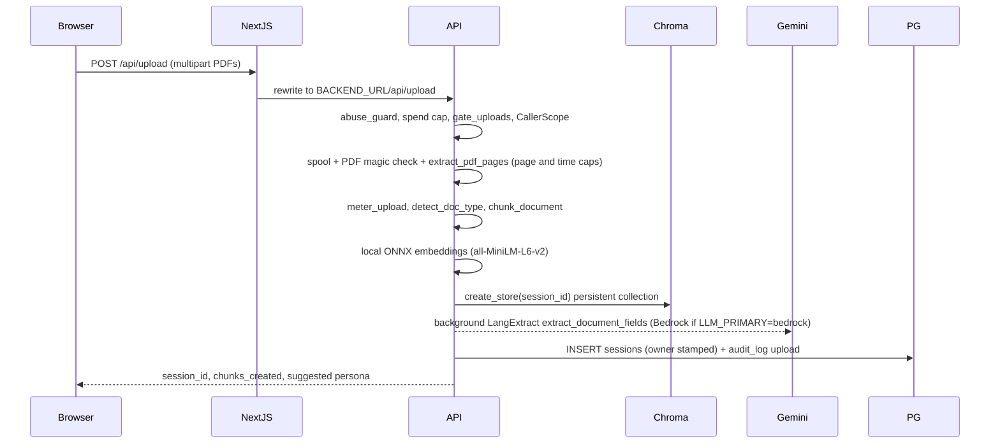

## 2. RAG document chat (`POST /api/chat`)

Handler: `chat`, `api/index.py:1202`. Dependencies: `_spend_cap`, `_demo_spend_guard`, `CallerScope`.

1. `_require_session` checks ownership, then `charge_budget(..., "chat")` (`api/index.py:1215-1217`).
2. `get_or_load_store` loads the Chroma collection. If the collection is gone, the route streams a `documents_expired` event instead of returning a 404 (`api/index.py:1222-1223`).
3. A request for a chart in docs-only mode (matched by `_PLOT_INTENT_RE`) returns a short guidance message as `token`, `citations` and `done` events, with no LLM call (`api/index.py:1225-1248`).
4. Inside `event_stream()`:
   - **Audit and lineage.** An audit `query` event is logged and a `LineageCollector(run_id, "docs")` is started.
   - **Persona routing.** `route_persona(message, EXPERT_PERSONAS)` scores primary keywords at 2 points and secondary keywords at 1 point. The routed persona needs at least 2 points, otherwise the turn stays with Generalist (`api/utils/persona_router.py:18-32`). There are 6 personas in `api/personas.py:35-257`.
   - **Rephrase.** When there is chat history, `achat_completion` rewrites the question into a standalone query (`PROMPT_VERSION_DOC_CHAT_REPHRASE`).
   - **Query expansion.** `expand_query` is a deterministic synonym table with no network call (`api/utils/query_expansion.py:144`).
   - **Retrieval.** Each query variant runs in parallel through `retriever.invoke` (`similarity`, `k=8`) on a thread pool of up to 6 workers. Results go through `deduplicate_docs` (`api/index.py:1314-1356`).
   - **Prompt guard.** `prompt_guard` heuristically scans the retrieved chunks for injection patterns, and the context is wrapped as untrusted content (`api/index.py:~1369`, `api/utils/prompt_guard.py`).
   - **Generation.** `achat_completion_stream(..., max_tokens=2000)` streams the answer. Every chunk goes through `mask_pii` and is emitted as a `token` event. A dangling code fence is closed at the end.
   - **No reranker on this path.** The cross-encoder reranker is only called from `hybrid_service.rag_retrieve` (`hybrid_service.py:365-369`).
   - **Trace, citations and lineage.** `log_trace` writes an `agent_traces` row. The route then emits a `citations` event (with `routed_persona` and `trace_id`) and a `lineage` event (`emit_lineage`, which also persists `answer_lineage`).
   - **Persist.** The `messages` rows are inserted. When `should_compress` is true (20 or more new messages), `compress_session` runs in the background (`context_compressor.py:36`).
5. `credit_service.begin_billing(raw_request, "chat", ...)` reserves credits, `billing.stream(event_stream())` wraps the generator, and the settle runs when the stream closes (`api/index.py:1563-1567`).

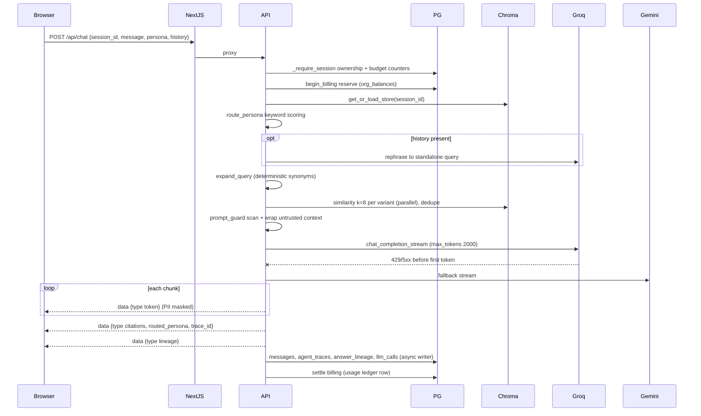

## 3. Database connect and 7-step SQL pipeline

### 3a. Connect (`POST /api/db/connect`, `api/index.py:1796` → `db_service.connect_database`, `db_service.py:857`)

1. `_gate_uploads` and `CallerScope` run first. The Pydantic validator on `host` performs the first SSRF check (`db_service.py:874`).
2. `_build_pinned_connection_url` resolves DNS and SSRF-validates every address, then pins the TCP connect to the checked IP. PostgreSQL gets a `hostaddr`, MySQL gets an IP host, and Azure SQL is validated but not pinned (`api/utils/connection_url.py:8-20,163`).
3. Azure SQL can authenticate with an Entra service principal token (`_get_entra_token`, `db_service.py:731`).
4. `_test_connection` connects with a 10-second timeout.
5. The credentials are encrypted with the org's envelope DEK, falling back to Fernet with `DB_ENCRYPTION_KEY` (`_encrypt_creds_for_connection`, `db_service.py:835`). The result is stored in `db_connections.credentials_blob`.
6. `_introspect_schema_from_url` collects tables and views, capped at 200 objects. Postgres tables are sorted by row estimate. Sample values are attached within a budget (`db_service.py:1206-1270`).
7. An audit event records the host and dialect only. Passwords are never logged.

### 3b. Query (`POST /api/db/chat`, `api/index.py:1964` → `run_sql_pipeline`, `db_service.py:1330`)

The pipeline makes 3 LLM calls in the typical case and 6 at most, with no loops (`db_service.py:1349-1356`).

| Step | What | Code |
|---|---|---|
| 0 | Conversational rephrase, only when there is history | `_rephrase_with_history` `db_service.py:677`, max_tokens 1000 |
| CSV | If `dialect == "csv"`, the request short-circuits to `run_csv_query_on_e2b` (section 4) | `db_service.py:1403-1458` |
| 1 | Schema retrieval: `schema_cache` table, or introspect on a miss | `get_schema` `db_service.py:1027` |
| 2 | Table selector: semantic top-k from `table_embeddings`, then an optional ontology pre-filter (`ontology_service.ontology_lookup`, top_k 8), with an LLM fallback | `table_selector.select_relevant_tables` (top_k 5), `_select_relevant_tables` `db_service.py:1792` |
| 3 | Few-shot: cosine similarity over `query_embeddings` | `_retrieve_few_shot` `db_service.py:1881` |
| 4 | SQL generation through `chat_completion`, max_tokens 1200, with an exact-match `llm_cache` lookup first | `_generate_sql` `db_service.py:1925-2001` |
| 5 | Validation: sqlglot AST, read roots only (`Select`, `Union`, `Intersect`, `Except`), LIMIT injected. On failure, one corrective LLM retry | `validate_and_sanitize_sql` `api/utils/sql_validator.py:27`, `_generate_validated_sql` `db_service.py:2005` |
| 6 | Execute on the pooled engine (LRU, 20 engines), read-only transaction, 15 s timeout, 500-row cap. On a table/column-not-found error: invalidate the cache, re-introspect, regenerate and retry once, then rebuild the ontology in the background | `_execute_query` `db_service.py:2056`, drift retry `db_service.py:1575-1615` |
| 7 | Answer generation through `chat_completion_stream`, max_tokens 1500, with line-buffered PII masking | `_stream_answer` `db_service.py:2194` |

After the answer, the pipeline stores `query_history` and `query_embeddings` (`_store_query_history`, `db_service.py:2269`) and the `sql_result` session artifact.

**Read-only enforcement has three layers:**

1. **Prompt.** The SQL generation prompt says "Read-only queries ONLY" (`db_service.py:1961`).
2. **sqlglot AST validation.** Only SELECT-family roots are accepted. Only SQLite executes the validated text verbatim. Every other dialect executes sqlglot's regenerated SQL, which closes parser-differential tricks such as MySQL `/*! */` comments (`sql_validator.py:38-71`).
3. **Database transaction.**
   - PostgreSQL: `SET TRANSACTION READ ONLY` and `SET LOCAL statement_timeout = '15000'`.
   - MySQL: `SET SESSION TRANSACTION READ ONLY`.
   - SQLite: the connection is opened in read-only mode (inferred from the `_execute_query` docstring, `db_service.py:2068-2091`).

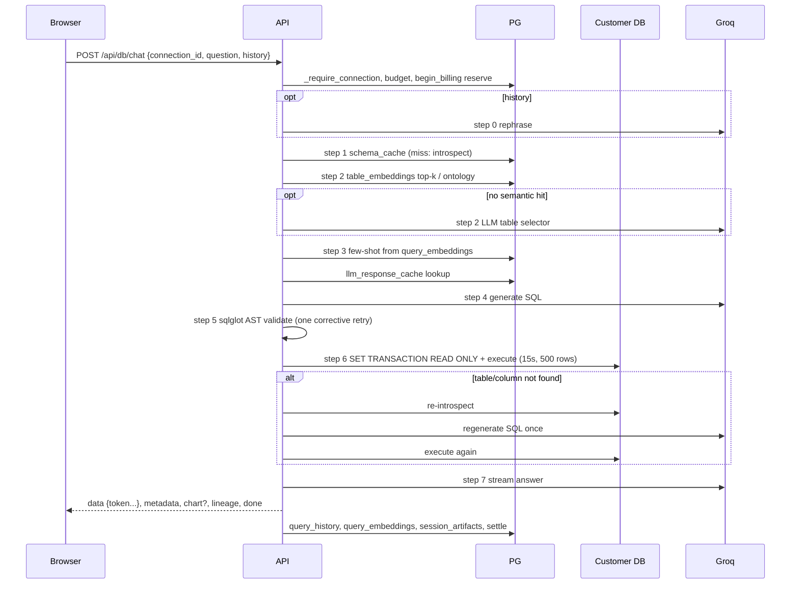

## 4. CSV upload and pandas on E2B

**Upload (`POST /api/db/upload/csv`, `api/index.py:2135`).** `read_upload_capped` limits the upload to `CSV_MAX_BYTES`. Then `file_upload_service.upload_csv` runs: it detects sections, builds a deterministic `DataProfile` (dtypes, sample rows, `describe()`, datetime columns, null percentages) and stores the raw CSV bytes plus the profile in an encrypted `credentials_blob` with `dialect="csv"`. Finally `stamp_connection_owner` sets the owner and a `first_upload` funnel event is recorded.

**Query.** `/api/db/chat` reaches `run_sql_pipeline`, which sees `dialect == "csv"` and hands off to `run_csv_query_on_e2b` (`sandbox_service.py:1478`). The SQL steps never run.

1. `_rephrase_for_csv` rewrites follow-up questions using `GROQ_CODE_MODEL`, max_tokens 1000 (`sandbox_service.py:947`).
2. `_COMPLEX_QUERY_RE` marks complex questions (predict, forecast, model and so on). Complex questions get a 60 s sandbox timeout and up to 8000 code-generation tokens. Other questions get 30 s and 2000 tokens (`sandbox_service.py:1028-1033,1517-1519`).
3. `generate_csv_analysis_code` prompts with the profile and the section-aware preamble. It tries `GROQ_CODE_MODEL` (`openai/gpt-oss-120b`) first and falls back to `GROQ_MODEL` (`openai/gpt-oss-20b`) (`sandbox_service.py:1000-1180`).
4. `_run_csv_in_sandbox` uploads the CSV and runs the code. `sandbox_policy.create_sandbox` creates the sandbox with internet off by default, a 60 s lifetime and pre-baked packages (scikit-learn, scipy, seaborn, plotly). On `ModuleNotFoundError` it retries once in a pip-egress sandbox, if egress is allowed (`sandbox_policy.py:48-54`, `sandbox_service.py:398-427`). Keepalive frames are streamed while the sandbox runs.
5. If the sandbox errors (not a timeout), the error is fed back to the LLM for one corrective code generation. The retry is skipped when the new code is identical to the old code (`sandbox_service.py:1636-1680`).
6. Matplotlib figures are captured through patched `show`/`savefig`, emitted as `chart` events and stored as artifacts. `_format_stdout_as_markdown` formats stdout as markdown. `meter_sandbox` records E2B seconds, including on error.

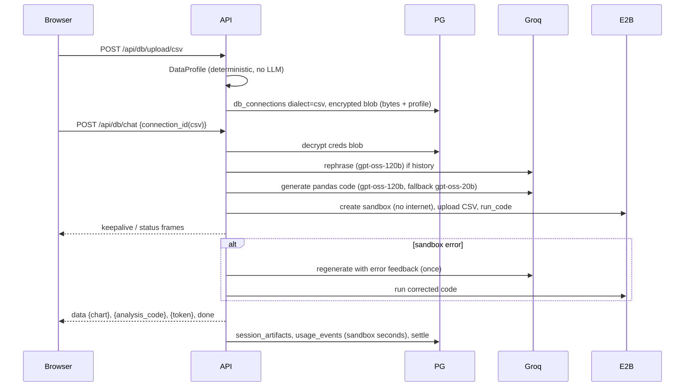

## 5. Hybrid docs + DB with discrepancy detection (`POST /api/hybrid/chat`)

Route: `hybrid_chat_route`, `api/index.py:2349` → `hybrid_service.hybrid_chat`, `hybrid_service.py:540`. The route checks both session and connection ownership, calls `charge_budget(..., "hybrid")`, then `begin_billing(route="hybrid")`.

1. **Intent classification** (`classify_intent`, `hybrid_service.py:135`):
   - A deterministic regex forces `hybrid` for comparison and discrepancy wording (`hybrid_service.py:59-66`).
   - Otherwise an LLM call with `GROQ_MODEL` at max_tokens 1000 and temperature 0 classifies the question. It goes through the exact-match `llm_cache` (`hybrid_service.py:196-218`).
   - Any value outside `sql`, `doc` and `hybrid` becomes `hybrid`.
   - A `metadata` event reports `{intent, has_sql, has_docs}`.
2. **Context gathering:**
   - `doc` intent: `rag_retrieve` runs similarity search (k=8) for each `expand_query` variant, dedupes, then reranks with the cross-encoder (`rerank_scored`, top_k 5) (`hybrid_service.py:325-420`).
   - `sql` intent: `_collect_sql_result` runs the full SQL pipeline without streaming, and forwards chart and analysis-code events.
   - `hybrid` intent: both branches run in parallel (`asyncio.gather`). If the SQL side times out, the route shows `SQL_TIMEOUT_NOTICE`.
3. **Discrepancy detection.** This step is deterministic, with no LLM. `detect_discrepancies(doc_context, sql_metadata)` extracts numbers from the document text and the SQL rows, then aligns them by period (Q/FY), label similarity and scale. Severity is high at 1.0% difference or more and medium at 0.5% or more. Each discrepancy gets a `[[discrepancy:<id>]]` marker in the prompt block (`api/utils/discrepancy_detector.py:25-29,158`).
4. **Synthesis.** `achat_completion_stream(max_tokens=2000)` streams the answer. Tokens are PII-masked and emitted as `token` events. The answer carries dual citations (`hybrid_service.py:~860-890`).
5. **Active discrepancy gate** (DOCBOT-1518). If the report contains discrepancies and the answer never mentions one (`_answer_addresses_discrepancies`, a substring check), one corrective `achat_completion` runs and a `replace` event swaps in the corrected text (`hybrid_service.py:~900-955`).
6. **Close.** Markers are cleaned up, then the route emits the `lineage` event (with discrepancies), writes the trace and sends `done`.

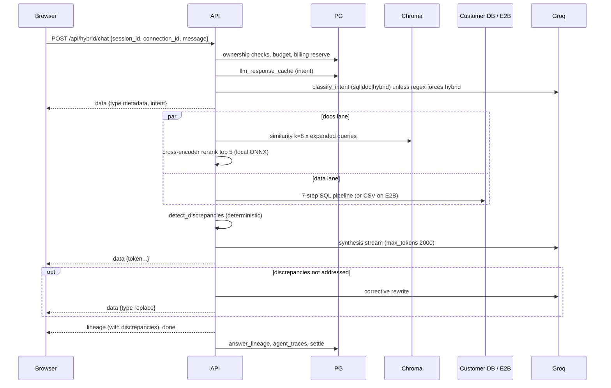

## 6. Analytical Autopilot (`POST /api/autopilot/run`)

**Frontend trigger.** The client turns on Autopilot automatically when the question matches `MULTI_STEP_TRIGGER` (`predict|forecast|what-if|simulat|root-cause|deep-dive|break-down|investigat|diagnos|scenario|correlat|regress|cluster|anomal|outli`) or `COMPLEX_COMPARE`. It does not trigger for simple visualisation requests, which match `SIMPLE_VIZ` (`src/hooks/useChatSubmit.ts:236-254`). The user can also choose Autopilot explicitly in `ToolPicker`.

**Route** (`api/index.py:2437`):

1. The route checks ownership (`allow_unbound` when there are no docs) and calls `charge_budget(..., "autopilot")`.
2. `resolve_autopilot_sources` re-derives `has_docs`, `has_db` and `has_csv` on the server from the vector store and the decrypted connection dialect. The client's hint flags are not trusted (`api/utils/autopilot_sources.py:131`).
3. `run_autopilot` runs (`autopilot_service.py:2231`), wrapped in `begin_billing(route="autopilot")`. The default reservation estimate is 150 credits.

**LangGraph** (`_build_graph`, `autopilot_service.py:2204-2223`):

| Node | Behaviour |
|---|---|
| `planner` (`_planner_node`, :200) | One LLM call produces a JSON list of steps. The prompt lists only the tools that are available. Regeneration is allowed once (`_PLANNER_REGENERATION_LIMIT=1`). `PROMPT_VERSION_AUTOPILOT_PLANNER` |
| `executor` (`executor_node`, :1408) | Dispatches one *wave* of independent steps through `asyncio.gather`. Each step has a `STEP_TIMEOUT_S` limit (env `AUTOPILOT_STEP_TIMEOUT_SECONDS`, default 45). A tool is chosen per step with `_select_tool_heuristic` (:374), with an optional LLM router (`PROMPT_VERSION_AUTOPILOT_TOOL_ROUTER`). The tools are `sql_query` (SQL pipeline), `doc_search` (`deep_retrieve`) and `python_analysis` (E2B, 60 s). Before each wave the executor checks `is_session_budget_exceeded(run_id)` (:1440) |
| conditional `_should_continue` (:2151) | Goes to `synthesize` when the run timed out, the budget is exceeded, every plan step is done, or `iteration >= MAX_ITERATIONS` (5 waves). Otherwise loops back to `execute` |
| `synthesizer` (`_synthesizer_node`, :1740) | `chat_completion`, max_tokens 2000, combining step results and normalized `data_results` |
| `verifier` (`_verifier_node`, :2003) | One `call_llm` that checks the synthesized numbers against the retrieved data, as an active discrepancy gate |

The overall wall clock is `TOTAL_TIMEOUT_S` (env `AUTOPILOT_TIMEOUT_SECONDS`, default 90). When it fires, a bounded partial synthesis answers from the steps that finished (`autopilot_service.py:2183-2201`).

SSE events are `plan`, then one `step` per finished step, then `answer`, `lineage` and `done` with `run_id` (`autopilot_service.py:2382-2564`).

**`deep_retrieve`** (`deep_research_service.py:69`):

1. One LLM call (`PROMPT_VERSION_DEEP_RETRIEVE_PLANNER`, 15 s timeout) decomposes the question into up to 5 sub-questions. The call is skipped if the run's cost ceiling has already been hit.
2. Each sub-question is expanded and retrieved in parallel (5 s timeout each).
3. A gap-fill loop re-retrieves only the sub-questions with no chunks, for up to `MAX_ITERATIONS=2` passes. The loop is pure vector search with no LLM calls.
4. The function returns `(deduped_docs, sub_questions)`.

The old standalone Deep Research route was retired (module docstring, `deep_research_service.py:1-11`).

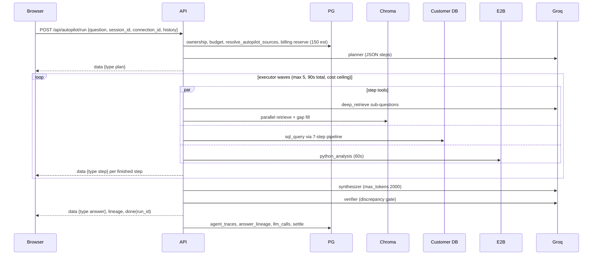

## 7. SEC EDGAR ingest (`POST /api/edgar/search|filings|ingest|ingest-batch`)

Routes are at `api/index.py:3485-3570`. `request_guard.edgar_guard(...)` rate-limits each action. Ingest also requires `_spend_cap` and `_caller_scope`.

1. **Search and list.** `EdgarConnector` fetches `company_tickers.json` and `data.sec.gov/submissions/CIK{cik}.json` through a shared `RateLimiter(calls_per_second=10)` with the SEC-required `User-Agent` (`api/connectors/edgar_connector.py:28-66`).
2. **Ingest** (`ingest_edgar_filing`, `edgar_service.py:98`):
   - **Cache hit.** If the accession number is in `edgar_filings_cache` and its vectors still exist, `clone_store` copies the collection into a new session owned by the caller (DOCBOT-1611) and returns `cached: true`.
   - **Cache miss.** `fetch_filing_text` downloads from `sec.gov/Archives` and strips the HTML with BeautifulSoup. The text then goes through `chunk_document`, `create_store`, a `sessions` insert with `source=edgar`, and an insert or update of the cache row. LangExtract extraction runs when it applies.
3. **Batch.** `ingest_multiple_filings` lists the filings and then ingests each one (`edgar_service.py:247`).

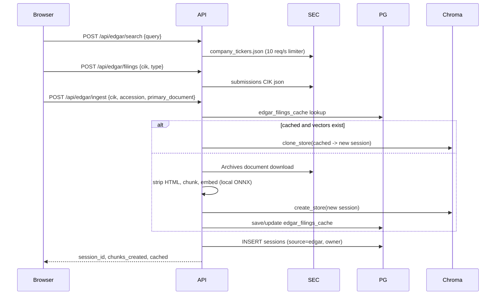

## 8. Commerce connectors (Shopify, Amazon SP-API)

Routes are in `api/routes/connector_routes.py`. Every route uses `require_connector_org`, which resolves the caller's org, and `_owned_connector` scopes each connector to that org (DOCBOT-1602).

1. **Register** (`POST /api/connectors/register`, :162):
   - Build the connector from the registry (`api/connectors/registry.py`).
   - For Shopify, `validate_shop_domain` and `validate_api_version` act as the SSRF guard (`shopify_connector.py:60-76`).
   - `connector.test_connection()` checks the credentials.
   - `save_connector` envelope-encrypts the credentials into `marketplace_connections`.
   - `register_sync_schedules(connector_id)` schedules the background syncs.
2. **Manual sync** (`POST /api/connectors/{id}/sync`, :268). `commerce_service.sync_connector_data` fetches orders and financials, `persist_orders` and `persist_financials` write `commerce_orders` and `commerce_financials`, and `update_last_sync` records the time. Any connector error returns a 502.
3. **Background sync** (`api/connectors/sync_jobs.py`):
   - APScheduler interval jobs run orders every 15 minutes and financials every 4 hours, with `max_instances=1`.
   - `sync_connector_incremental` reads from a `sync_cursor`, or looks back 30 days when there is no cursor.
   - On `ConnectorRateLimitError` a one-shot retry is scheduled at `retry_after * 1.5`.
   - Active connectors are re-registered at startup (`register_all_active_connectors`).
4. **Webhook** (`POST /api/marketplace/webhook/shopify`, :345). It requires the `X-Shopify-Hmac-SHA256` and `X-Shopify-Shop-Domain` headers. The HMAC is verified with the connector's webhook secret, then `sync_connector_data` runs.
5. **Amazon.** An LWA refresh token is exchanged at `api.amazon.com/auth/o2/token`, and the access token is cached for 55 minutes. Calls go to `sellingpartnerapi-na.amazon.com` (`amazon_connector.py:26-92`).
6. **Retention.** `register_retention_cleanup_job` nulls old `raw_json` columns (`commerce_service.py:439-512`).

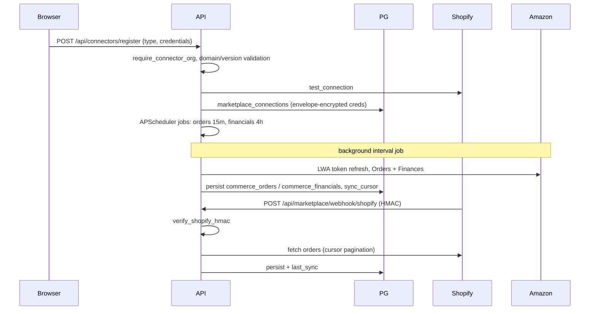

## 9. Billing, credits and metering

The unit is the credit: 1 credit = $0.001 retail. Raw provider cost is tracked in integer micro-USD (`api/billing_models.py`, `credit_service.py:1-50`).

1. **Meter.** `RequestMeter` is held in a ContextVar (`api/utils/billing_context.py`). Every LLM call reaches `meter_llm_call` from `llm_provider` (`llm_provider.py:58`, `usage_service.py:253`). E2B seconds go through `meter_sandbox` (`usage_service.py:287`) and uploads through `meter_upload`. Each call also enqueues a `usage_events` row, which a background writer persists. Thread-pool calls must use `copy_ctx_run` so the meter propagates.
2. **Reserve.** `begin_billing` (`credit_service.py:1016`) resolves the caller and detects demo resources. `start_billing_run` (`:960`) and `reserve` (`:562`) then make one atomic `UPDATE org_balances SET reserved = reserved + :est WHERE balance - reserved >= :est AND NOT frozen`. The default estimates are chat 20, db_chat 30, hybrid 40, sandbox 50 and autopilot 150, each overridable with `BILLING_EST_CREDITS_<ROUTE>` (`credit_service.py:126-187`). A lazy monthly free grant is inserted on the first billed request of the month (`DEFAULT_FREE_MONTHLY_CREDITS=500`).
3. **Shadow vs enforce.** When `BILLING_ENFORCE` is off (the default), a failed reservation only logs `would_block`. When it is on, the route returns HTTP 402 `insufficient_credits` or `account_frozen`.
4. **Settle.** `BillingRun.stream()` settles in a `finally` block through `asyncio.shield`, so the settle also runs when the client disconnects. It converts `meter.snapshot().cost_micro_usd` to credits × `BILLING_MARKUP` (default 3.5, minimum 10/3), releases the reservation, debits the balance (never below 0) and writes one `usage` ledger row with `ref=run_id` (`credit_service.py:628,835-905`).
5. **Reap.** Reservations that were never settled are released after `BILLING_RESERVATION_TTL_MINUTES` (default 15). The reaper runs at startup and as an APScheduler job every 5 minutes.
6. **Exempt callers.** Anonymous callers and demo-only requests get no reservation and no ledger row. The `request_guard` budgets cover them instead.
7. **Purchase.**
   - `POST /api/billing/checkout` (org admin only) creates a Stripe Checkout Session over plain `httpx`. The session is in `payment` mode and carries `metadata[org_id, pack_id, credits, user_id]` (`billing_service.py:110-150`).
   - `POST /api/billing/webhook` (`billing_service.WEBHOOK_PATH`) verifies `Stripe-Signature` with HMAC-SHA256 over `"{t}.{payload}"` and a timestamp tolerance (`billing_service.py:193`). It handles `checkout.session.completed` and `checkout.session.async_payment_succeeded`, then calls `grant_purchase`, which is idempotent through `UNIQUE(kind, ref)`.
   - Platform admins can grant credits manually with `POST /admin/credits/grant`.
8. **Platform cap.** `spend_guard.check_platform_capacity` sums today's `llm_calls` and `usage_events` cost and returns 503 to free-tier callers above `PLATFORM_DAILY_USD_CAP` (`api/utils/spend_guard.py:57-136`).

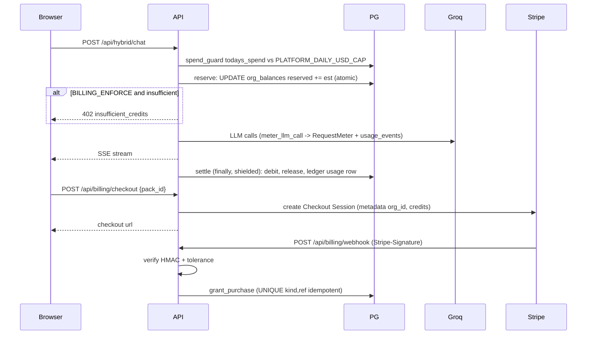

## 10. Authentication and sessions

All login methods end the same way:

1. `create_user_session` stores **only** `sha256:` + the hex digest of the token in `user_sessions.token` (`auth_service.py:252-283`).
2. The raw token is set as the `docbot_session` cookie: HttpOnly, `SameSite=Lax`, Secure when `APP_BASE_URL` is https, with `max_age = SESSION_TTL_HOURS` (default 8).
3. `_claim_anon_work` moves any sessions and connections owned by the anonymous cookie to the new user.

| Method | Route(s) | Key steps |
|---|---|---|
| SAML 2.0 | `GET /api/auth/saml/login` → IdP → `POST /api/auth/saml/acs` | `OneLogin_Saml2_Auth` (python3-saml) validates the signed assertion. `identity_from_saml_attrs` and `resolve_provider_login` link the user to a `user_identities` row by subject (JIT provisioning). Redirects to `/chat?sso=success` (`api/index.py:2566-2650`, `auth_service.py:144-230`) |
| GitHub OAuth | `GET /api/auth/github` → `/callback` | A random `state` is stored in the `OAUTH_STATE_COOKIE`. The callback checks that the cookie matches (login CSRF) and that the state is within its TTL and unused, then exchanges the code and resolves the user by provider subject (`api/index.py:2729-2798`) |
| Google OAuth | `GET /api/auth/google` → `/callback` | Same as GitHub, plus PKCE: the verifier is carried in the state cookie (`api/index.py:2800-2870`) |
| Email/password | `POST /api/auth/register`, `POST /api/auth/login` | Register runs an HIBP k-anonymity breach check (fails open), enforces Turnstile when configured and stores a bcrypt hash. Accounts are unique by canonical email. Login is throttled per email and IP (`check_login_throttle`). bcrypt always runs, against a dummy hash when needed, so response timing is constant. Unverified accounts get a 403 when verification is enabled (`api/index.py:2896-3034`) |
| Email verification | `POST /api/auth/verify` (`email_verify_routes.py:47`) | Active only when `RESEND_API_KEY` and `EMAIL_FROM` are set. Register then returns 202 `verification_required` and emails a single-use link through the Resend HTTP API. The stored token is a SHA-256 hash. Resends are throttled to one per 60 s. Consuming the token marks the account verified and can grant free credits (`email_verification_service.py:65-266`) |
| Owner unlock | `POST /api/auth/owner-unlock` | Exchanges the `X-Owner-Key` header for an HMAC'd `docbot_owner` cookie, which bypasses every abuse guard (`api/index.py:2696`) |
| Logout / me | `POST /api/auth/logout`, `GET /api/auth/me`, `GET /api/auth/workspace` | Deletes the session row by token hash. `me` returns the user and role |

`AUTH_REQUIRED` (open mode by default) decides whether `require_role` enforces anything (`rbac_service.py:96`). Admin routes always need a logged-in admin (`require_admin`, `:129`), and platform-wide routes also need the user id to be in `PLATFORM_ADMIN_USER_IDS` (`:161-173`).

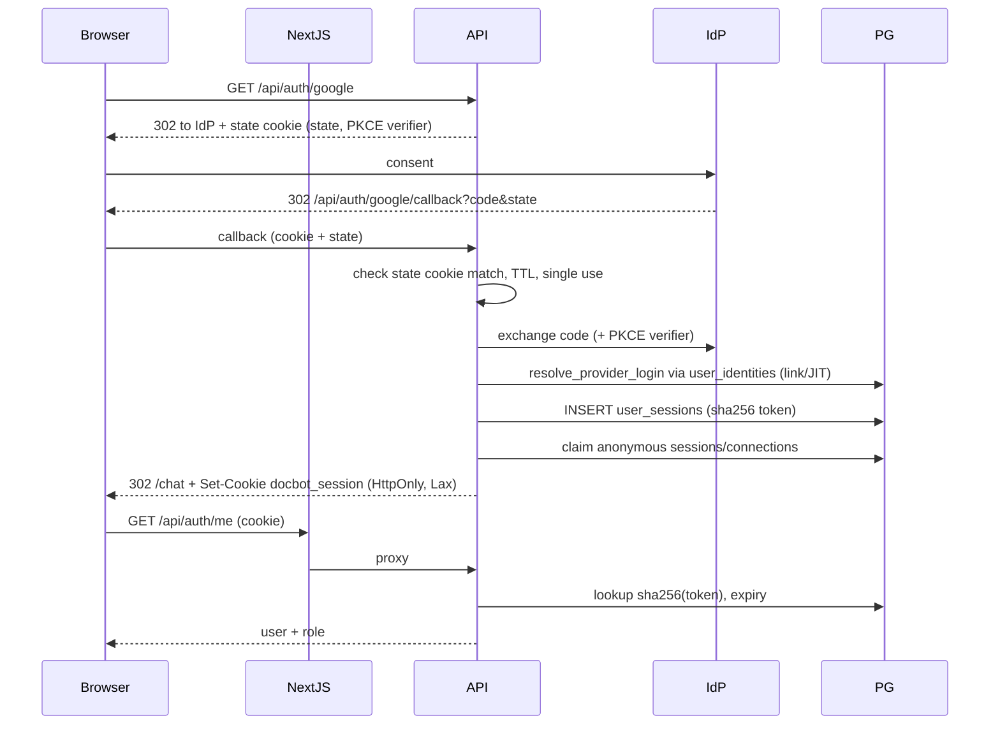

## 11. Developer API keys (`/v1/*`)

1. **Issue.** `POST /admin/api-keys` requires an org admin. `create_api_key` generates `dk_live_<token_urlsafe>`, stores only its SHA-256 plus a 16-character display prefix, and requires `scopes` to be a subset of `hybrid:read`, `lineage:read`, `autopilot:run` and `connectors:manage` (`api_key_service.py:84-89,216-270`). The raw key is returned once.
2. **Use.**
   - `require_api_key(scope)` reads `Authorization: Bearer <key>`, hashes it, looks it up, rejects revoked keys and checks the scope.
   - It applies a per-key token-bucket limit (`V1_RATE_LIMIT_CALLS_PER_SECOND=5`).
   - The key's org becomes the billing principal (`api_key_service.py:363-405`).
   - Note: CORS only allows the `Content-Type` request header, so `/v1` is meant for server-to-server calls, not browsers (inferred from `api/index.py:61`).
3. **Routes** (`api/index.py:3600-3981`):
   - `POST /v1/hybrid/chat` runs `hybrid_chat` internally, collects the SSE events and returns one JSON object: `{answer, citations, intent, has_sql, has_docs, ...}`.
   - `POST /v1/autopilot/run` is collected the same way.
   - `GET /v1/lineage/{run_id}`.
   - `GET/POST /v1/connectors` and `POST /v1/connectors/{id}/sync`.
   - `_require_v1_resources` returns 404 for any body-supplied `session_id` or `connection_id` outside the key's org (DOCBOT-1603). `_begin_v1_billing` reserves credits against the key's org (DOCBOT-2330).

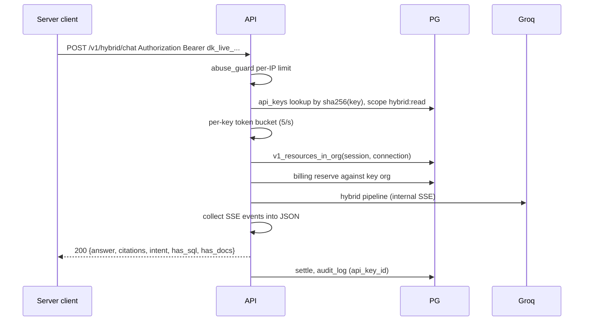
