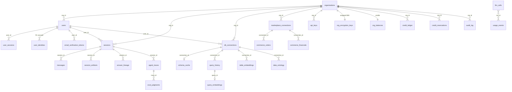

# Data Model

Sources: api/index.py, api/org_service.py, api/identity_service.py, api/email_verification_service.py, api/utils/envelope_encryption.py, api/utils/encryption.py, api/connector_store.py, api/commerce_service.py, api/llm_trace_service.py, api/usage_service.py, api/credit_service.py, api/lineage_service.py, api/utils/llm_cache.py, api/trace_service.py, api/ontology_service.py, api/eval_service.py, api/api_key_service.py, api/funnel_service.py, api/waitlist_service.py, api/audit_service.py, api/utils/request_guard.py, api/utils/caller_scope.py, api/utils/vector_store.py, api/file_upload_service.py, api/db_service.py, api/routes/onboarding_routes.py

Last verified against code: 2026-11-23

## 1. Storage overview

| Store | Technology | What lives there | Defined in |
|---|---|---|---|
| Control-plane DB | PostgreSQL (Railway), async SQLAlchemy + asyncpg | All 33 application tables below | `api/index.py:147-170` (engine, `pool_size=5`, `max_overflow=10`, `pool_pre_ping`) |
| Vector store | ChromaDB persistent client on local disk (`CHROMA_DIR`, legacy `CHROMA_PERSIST_DIR`, default `<tempdir>/docbot_chroma`) | One collection per chat session: chunk text + 384-dim embeddings | `api/utils/vector_store.py:1-60`, `:75-100` |
| In-process caches | Python dicts / LRU | `VECTOR_STORES` (LRU, `VECTOR_STORE_CACHE_MAX`, default 64), `EXTRACTED_FIELDS`, `_engine_cache` (customer DB engines, max 20), connector instances on `app.state.connectors`, OAuth `_pending_states` | `api/index.py:812-817`, `api/utils/vector_store.py:100-140`, `api/db_service.py:147-149`, `api/index.py:660-700`, `api/oauth_service.py:307` |
| Upload scratch | Host temp files | Uploaded SQLite files (2 h TTL), spooled uploads | `api/file_upload_service.py:43`, `api/utils/upload_limits.py` |
| Customer databases | Customer PostgreSQL / MySQL / Azure SQL | Never copied; read-only queries only | `api/db_service.py:2052-2110` |

There is no migration framework (no Alembic). Schema is created by `metadata.create_all` plus idempotent `ALTER TABLE ... ADD COLUMN IF NOT EXISTS` / `CREATE INDEX IF NOT EXISTS` statements in `init_db()` (`api/index.py:512-594`), run on every boot from the FastAPI lifespan (`api/index.py:598-603`).

## 2. Entity-relationship diagram (main relations)

Foreign keys are mostly logical (string ids, no DB constraint). The only declared FK is `user_identities.user_id -> users.id ON DELETE CASCADE` (`api/identity_service.py:155-161`).

## 3. Table catalogue

Column notation: `PK` primary key, `U` unique, `IX` indexed, `NN` not null. All timestamps are `TIMESTAMPTZ`.

### 3.1 Core chat / documents

**`sessions`** — `api/index.py:172-192`. One row per chat workspace.

| Column | Type | Notes |
|---|---|---|
| session_id | String PK | UUID, or `demo-...` for demo sessions (inferred from `api/utils/caller_scope.py:270`) |
| created_at / updated_at | timestamptz NN | `updated_at` drives vector-store retention |
| persona | String | default `Generalist` |
| file_count, files_info | Integer, Text | |
| context_summary, last_compressed_at, message_count_at_compression | Text, timestamptz, Integer | DOCBOT-502 context compression |
| user_id | String IX | owner when logged in |
| source | String | `upload` / `edgar` / `demo` |
| org_id | String IX | tenant |
| anon_owner | String IX | SHA-256 of `docbot_anon` cookie |

**`messages`** — `api/index.py:194-202`: `id` Integer PK autoincrement, `session_id` IX NN, `role` NN, `content`, `sources` (JSON text), `timestamp` NN. No owner columns; access is via the owning session.

**`session_artifacts`** — `api/index.py:310-321`: `id` PK, `session_id` IX NN, `turn_id` NN, `artifact_type` (`dataframe|chart|sql_result`), `name` NN, `data_json` (max 500 rows), `chart_b64` (base64 PNG), `row_count`, `columns`, `created_at`.

### 3.2 Identity, auth and tenancy

**`organizations`** — `api/org_service.py:100-118`: `id` PK, `name` NN, `created_at`. A default org is created and backfilled on boot (`backfill_default_organization`, `api/index.py:567`). DOCBOT-1702 gives each signup a personal org (`api/org_service.py:121+`).

**`users`** — `api/index.py:222-242`

| Column | Type | Notes |
|---|---|---|
| id | String PK | UUID |
| email | String NN U IX | |
| name | String NN | |
| provider | String NN | `github|google|email|okta|azure_ad|saml` |
| provider_id | String | |
| password_hash | Text | bcrypt (`api/oauth_service.py:241-251`) |
| email_verified | Boolean NN default false | DOCBOT-1617 |
| role | String NN default `analyst` | `viewer|analyst|admin` |
| last_login_at, created_at | timestamptz | |
| org_id | String IX | |
| use_case | String | onboarding answer (DOCBOT-1712) |
| email_canonical | String | unique index `uq_users_email_canonical` (DOCBOT-2332) |

**`user_sessions`** — `api/index.py:244-251`: `id` PK, `user_id` IX NN, `token` U IX NN (stored as `sha256:<hex>` of the cookie token, `api/auth_service.py:252-260`; legacy plaintext rows rewritten at boot `api/index.py:538-539`), `expires_at` NN, `created_at`.

**`user_identities`** — `api/identity_service.py:149-170`: `id` PK, `user_id` FK→`users.id` CASCADE IX, `provider` NN, `provider_sub` NN, `email`, `email_verified` NN, `created_at`. Unique `(provider, provider_sub)`.

**`email_verification_tokens`** — `api/email_verification_service.py:98-115`: `token_hash` PK (SHA-256 of emailed token), `user_id` IX NN, `email` NN, `expires_at` NN (24 h, `:68`), `used_at`, `created_at`.

**`api_keys`** — `api/api_key_service.py:100-118`: `id` PK, `org_id` IX NN, `key_hash` U IX NN (SHA-256), `key_prefix` NN (first 16 chars for display), `name` NN, `scopes` (JSON array), `created_at`, `last_used_at`, `revoked_at`.

**`org_encryption_keys`** — `api/utils/envelope_encryption.py:115-134`: `org_id` PK, `wrapped_dek` Text NN, `created_at`.

### 3.3 Live database connectivity

**`db_connections`** — `api/index.py:255-272`

| Column | Type | Notes |
|---|---|---|
| id | String PK | UUID |
| session_id | String IX NN | |
| dialect | String NN | `postgresql|mysql|sqlite|azure_sql|csv` |
| host, port, dbname | NN | `host='__local_file__'` marks uploaded SQLite/CSV (`api/file_upload_service.py:425-430`) |
| credentials_blob | Text NN | encrypted JSON (see section 5); CSV bytes + DataProfile live here for `dialect=csv` |
| pii_masking_enabled | Boolean NN default false | DOCBOT-604 |
| created_at | timestamptz | |
| user_id, org_id, anon_owner | String IX | ownership |

**`schema_cache`** — `api/index.py:274-279`: `connection_id` PK, `schema_json` NN, `expires_at` NN (24 h, `api/db_service.py:957`).

**`query_history`** — `api/index.py:281-289`: `id` PK, `connection_id` IX NN, `nl_question` NN, `sql_query` NN, `result_summary`, `created_at`.

**`query_embeddings`** — `api/index.py:291-295`: `query_id` PK (→query_history.id), `embedding_json` NN. Used for few-shot retrieval.

**`table_embeddings`** — `api/index.py:299-306`: composite PK `(connection_id, table_name)`, `embedding` (JSON float[384]), `schema_summary`, `updated_at`.

**`data_ontology`** — `api/ontology_service.py:195-219`: `id` PK, `connection_id` IX NN, `table_name` NN, `column_metadata_json` NN, `embedding` NN, `data_card_json`, `join_hints_json`, `updated_at`; unique `(connection_id, table_name)`.

### 3.4 Connectors and EDGAR

**`marketplace_connections`** — `api/connector_store.py:76-107`: `id` PK, `connector_type` NN (`amazon|shopify`), `encrypted_credentials` NN, `is_active` NN default true, `sync_status` (`idle|syncing|auth_failed|error`), `sync_cursor` (ISO date), `last_sync_at`, `created_at`, `updated_at`, `org_id` IX.

**`commerce_orders`** — `api/commerce_service.py:103-120`: `id` PK, `connection_id` IX NN, `connector_type` NN, `marketplace_order_id` NN, `status` NN, `total_amount` Float NN, `currency`, `order_date` IX, `customer_id`, `raw_json`, `created_at`, `updated_at`; unique index `uq_commerce_orders_conn_mkt (connection_id, marketplace_order_id)`.

**`commerce_financials`** — `api/commerce_service.py:122-137`: `id` PK, `connection_id` IX NN, `connector_type`, `period_start` IX NN, `period_end` NN, `revenue`, `refunds`, `fees`, `net_proceeds` (Float NN), `currency`, `raw_json`, `created_at`.

**`edgar_filings_cache`** — `api/connector_store.py:48-73`: `id` PK, `cik` IX NN, `accession_number` U NN, `filing_type` NN, `filing_date` NN (string), `company_name`, `ticker` IX, `session_id`, `text_hash`, `created_at`. Not org-scoped (public SEC data).

### 3.5 Observability, lineage, eval

**`llm_calls`** — `api/llm_trace_service.py:69-106`: `id` PK, `run_id` IX NN, `provider` NN, `model` NN, `caller` IX, `prompt_version` IX, `latency_ms`, `input_tokens`, `output_tokens`, `estimated_cost_usd`, `success` NN, `fallback_triggered` NN, `error_message` (sanitized), `org_id` IX, `user_id`, `key_source` (`platform|byok`), `created_at` IX. Written by a background queue writer (`api/index.py:629-633`). Metadata only — no prompt/response text.

**`usage_events`** — `api/usage_service.py:83-111`: `id` PK, `org_id`, `user_id`, `session_id`, `run_id` (joins `llm_calls.run_id`), `kind` NN (`llm|sandbox|upload|request`), `route`, `provider`, `model`, `prompt_tokens`, `completion_tokens`, `cost_micro_usd` BigInteger, `sandbox_ms`, `bytes`, `pages`, `key_source` NN default `platform`, `created_at`; index `ix_usage_events_org_created`.

**`answer_lineage`** — `api/lineage_service.py:34-46`: `run_id` PK, `session_id` IX, `connection_id` IX, `mode` NN, `data_json` NN, `created_at`.

**`agent_traces`** — `api/trace_service.py:65-96`: `id` PK, `run_id` IX, `session_id` IX, `connection_id` IX, `pipeline` IX NN (`autopilot|hybrid|db_chat|chat`), `question` NN, `intent_classified`, `tool_chosen`, `plan_steps_json`, `retrieved_refs_json`, `final_answer` (truncated), `latency_ms`, `cost_usd`, `error`, `user_feedback` (`up|down`), `implicit_signal`, `created_at`.

**`eval_judgments`** — `api/eval_service.py:89-111`: `id` PK, `trace_id` IX NN, `tool_selection_verdict` NN, `tool_selection_reason`, `evidence_support_verdict` NN, `evidence_support_reason`, `judged_at` IX.

**`llm_response_cache`** — `api/utils/llm_cache.py:89-110`: `id` PK, `prompt_hash` IX NN, `model` IX NN, `response` NN, `created_at`, `expires_at` IX NN (default TTL 6 h, `:81`); unique `(prompt_hash, model)`.

### 3.6 Billing and growth

**`org_balances`** — `api/credit_service.py:222-230`: `org_id` PK, `balance_credits` BigInteger NN, `reserved_credits` BigInteger NN, `updated_at` NN, `frozen` Boolean NN. 1 credit = $0.001.

**`credit_ledger`** — `api/credit_service.py:231-245`: `id` PK, `org_id` NN, `kind` NN, `ref` NN, `delta_credits` NN, `balance_after_credits`, `description`, `created_at`; unique `(kind, ref)` (idempotency), index `(org_id, created_at)`. Append-only via trigger `credit_ledger_immutable` (`api/credit_service.py:264+`, installed `api/index.py:573-574`).

**`credit_reservations`** — `api/credit_service.py:246-258`: `id` PK (billing run_id), `org_id` NN, `route` NN, `credits` NN, `status` NN (`open|settled|released`), `actual_credits`, `created_at`, `closed_at`; index `(status, created_at)`. Reservation TTL 15 min (`:121`); orphaned reservations released at boot (`api/index.py:637`) and by a periodic reaper (`api/credit_service.py:786-795`).

**`funnel_events`** — `api/funnel_service.py:50-64`: `id` PK, `user_id`, `org_id`, `anon_owner`, `event` NN, `created_at` IX, `props` JSON; unique `(user_id, event)` and `(anon_owner, event)` for dedupe.

**`waitlist`** — `api/waitlist_service.py:26-41`: `id` PK, `email` U NN, `name` NN, `company` NN, `role`, `note`, `source` NN, `user_id`, `org_id`, `created_at` IX, `updated_at`.

### 3.7 Security / abuse

**`audit_log`** — `api/index.py:206-218`: `id` PK (UUID), `event_type` IX NN, `session_id` IX, `user_id` IX, `detail`, `metadata_json`, `occurred_at` IX NN, `org_id` IX. Event types: `query, db_connect, db_disconnect, upload, login, logout, api_key_use` (`api/audit_service.py:50-58`). See section 6.

**`rate_limit_counters`** — `api/index.py:327-335`, name from `api/utils/request_guard.py:178`: composite PK `(bucket, counter_key, window_start)`, `count` NN, `expires_at` BigInteger IX (epoch seconds). Atomic `INSERT ... ON CONFLICT DO UPDATE ... RETURNING` (`api/utils/request_guard.py:12-17`, `:213-234`).

Total registered tables: 33 (12 in `index.py` incl. `rate_limit_counters`, 21 via `register_*` helpers, `api/index.py:339-409`).

## 4. Tenant / owner scoping

| Mechanism | Tables | Rule | Source |
|---|---|---|---|
| `user_id` + `org_id` | sessions, db_connections, marketplace_connections, users, audit_log, llm_calls, usage_events, funnel_events, waitlist | Logged-in non-admin: `user_id = me AND org_id = my org`; org admin: `org_id = my org AND user_id IS NOT NULL` (never anonymous rows) | `api/utils/caller_scope.py:298-316` |
| `anon_owner` (SHA-256 of `docbot_anon` cookie) | sessions, db_connections, funnel_events | Anonymous: `anon_owner = digest AND user_id IS NULL`; no cookie matches nothing | `api/utils/caller_scope.py:43-51`, `:313-315`, migrations `:327-333` |
| API-key org scope | sessions, db_connections (for `/v1/*`) | Row must be in key's org AND user-owned | `api/resource_scope_service.py:19-40`, `api/db_service.py:269-284` |
| `connection_id` "RLS" | commerce_orders, commerce_financials | Every query helper requires `connection_id`; the connection itself is checked against the caller's org (`connector_in_org`). This is application-level filtering, not PostgreSQL Row-Level Security | `api/commerce_service.py:12`, `:301-357`, `api/routes/connector_routes.py:69-75` |
| Via parent | messages, session_artifacts, answer_lineage, agent_traces, query_history, schema_cache, table_embeddings, data_ontology | Owner check on parent session/connection before access | `api/index.py:483-508` (`_require_session`), `api/lineage_service.py:41` |
| Unscoped (global) | edgar_filings_cache, llm_response_cache, rate_limit_counters, eval_judgments | Shared, non-tenant data | — |

Non-owners receive 404, not 403 (`api/utils/caller_scope.py:52-54`). Rows created before DOCBOT-1601 with both `user_id` and `anon_owner` NULL match no caller.

## 5. Encryption at rest

| Data | Scheme | Source |
|---|---|---|
| `db_connections.credentials_blob`, `marketplace_connections.encrypted_credentials` | Per-org envelope encryption: KEK = `Fernet(DB_ENCRYPTION_KEY)`; one random Fernet DEK per org, stored wrapped in `org_encryption_keys.wrapped_dek`; blob format `ENV1:<org_id>:<fernet-token>` | `api/utils/envelope_encryption.py:1-80`, `:252-301`; callers `api/db_service.py:49,97,851`, `api/connector_store.py:36,160` |
| Legacy blobs (no `ENV1:` prefix) | Flat Fernet with the KEK; lazily re-encrypted to envelope on next successful read (`decrypt_credentials_with_migration`), never batch-migrated | `api/utils/envelope_encryption.py:264-301`, `api/utils/encryption.py:15-33` |
| Session tokens, email tokens, API keys, anon cookie | SHA-256 hash only | `api/auth_service.py:259`, `api/email_verification_service.py:109`, `api/api_key_service.py:183`, `api/utils/caller_scope.py:114` |
| Passwords | bcrypt (72-byte truncation) | `api/oauth_service.py:241-251` |
| Chroma vector store | Plaintext SQLite on disk; at-rest encryption depends on the Railway volume (flagged OPEN GAP in code) | `api/utils/vector_store.py:28-48` |

Known limit (stated in code): compromise of the KEK exposes all DEKs; real KMS is the documented upgrade path (`api/utils/envelope_encryption.py:60-78`).

## 6. Audit log integrity

- Append-only: `init_db` installs PL/pgSQL function `audit_log_immutable()` and trigger `audit_log_no_mutate` that raises on UPDATE/DELETE (`api/audit_service.py:162-207`, `api/index.py:523-527`).
- Writes are fire-and-forget `asyncio.create_task`; failures are logged, never raised (`api/audit_service.py:61-100`). Client IP from `X-Forwarded-For` first hop (`api/audit_service.py:30-46`) — note this differs from the trusted-hop logic in `request_guard.client_ip`.
- Audit `detail` is PII-masked before insert (`api/audit_service.py:138`).
- `audit_log` is deliberately excluded from the default-org `org_id` backfill because the trigger blocks UPDATE (`api/org_service.py:79-90`).
- **Hash chain: not on `main`.** Per-org `prev_hash`/`row_hash` (sha256 over canonical row + prev hash, `pg_advisory_xact_lock` per org) and `GET /admin/audit/verify` exist only on unmerged branch `feature/DOCBOT-2501-audit-hash-chain` (commit 68f96f5). The `audit_log` table on `main` has no hash columns.

## 7. Retention and cleanup

| Data | Policy | Trigger | Source |
|---|---|---|---|
| Chroma vector stores | Deleted after `VECTOR_STORE_RETENTION_DAYS` (default 30) of session inactivity, keyed on `sessions.updated_at` | Boot + daily APScheduler job `vector_store_retention_cleanup` | `api/utils/vector_store.py:117-119`, `:356`; `api/index.py:722-768` |
| Uploaded SQLite files + their `db_connections`/`schema_cache` rows | 2 h TTL | Boot only | `api/file_upload_service.py:43`, `:411`; `api/index.py:649-657` |
| `commerce_*.raw_json` | Nulled after `COMMERCE_RAW_JSON_RETENTION_DAYS` (default 90); normalized fields kept | APScheduler job | `api/commerce_service.py:86`, `:479-530`; `api/index.py:714-715` |
| `credit_reservations` | Open reservations past TTL (15 min) released | Boot + reaper job | `api/credit_service.py:121`, `:786-795` |
| `rate_limit_counters` | Expired windows deleted opportunistically | Every N charges | `api/utils/request_guard.py:242-252` |
| `llm_response_cache` | `expires_at` (6 h default) | On read (inferred) | `api/utils/llm_cache.py:81` |
| `user_sessions` | `expires_at` = `SESSION_TTL_HOURS` (default 8) | Checked on lookup | `api/auth_service.py:33` |
| OAuth state | 5 min, in-memory | On use | `api/oauth_service.py:299-312` |
| `audit_log`, `credit_ledger` | Never deleted (immutability triggers) | — | above |
| `llm_calls`, `usage_events`, `agent_traces`, `messages`, `answer_lineage` | No automated retention found | — | (no job in `api/index.py` lifespan) |

## 8. Boot-time migrations (`init_db`, `api/index.py:512-594`)

In order: `create_all`; sessions compression columns; audit immutability trigger; `users.provider_id/password_hash`; `USER_IDENTITY_COLUMN_MIGRATIONS` (`email_verified`, `email_canonical`, `api/identity_service.py:173-176`); `users.use_case` (`api/routes/onboarding_routes.py:24-26`); `backfill_legacy_identities`; `backfill_email_canonical` then unique index; `hash_legacy_session_tokens`; `db_connections.pii_masking_enabled`; `user_id` on sessions/db_connections; `sessions.source`; `ORG_ID_COLUMN_MIGRATIONS` (users, sessions, db_connections, marketplace_connections, audit_log, `api/org_service.py:71-77`); `ANON_OWNER_COLUMN_MIGRATIONS`; `LINEAGE_COLUMN_MIGRATIONS` (`connection_id` on answer_lineage + agent_traces, `api/lineage_service.py:50-55`); `backfill_default_organization`; `LLM_CALLS_BILLING_MIGRATIONS` + `USAGE_EVENTS_MIGRATIONS` (`api/usage_service.py:67-80`); credit ledger trigger; `FUNNEL_EVENTS_DDL` unique indexes.
