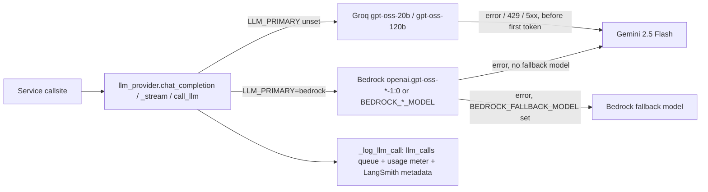
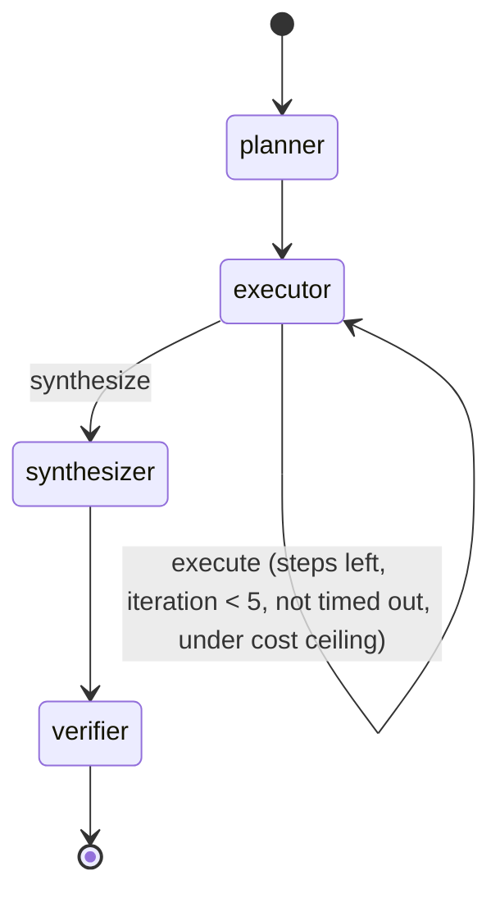

# AI / LLM Architecture

Sources: `api/utils/llm_provider.py`, `api/utils/_gemini_wrapper.py`, `api/utils/llm_cache.py`, `api/utils/embeddings_provider.py`, `api/utils/embeddings.py`, `api/utils/reranker.py`, `api/utils/chunker.py`, `api/utils/vector_store.py`, `api/utils/query_expansion.py`, `api/utils/context_compressor.py`, `api/utils/persona_router.py`, `api/utils/prompt_guard.py`, `api/utils/response_format.py`, `api/utils/langsmith_tracing.py`, `api/utils/langsmith_pin.py`, `api/utils/spend_guard.py`, `api/personas.py`, `api/hybrid_service.py`, `api/db_service.py`, `api/sandbox_service.py`, `api/autopilot_service.py`, `api/deep_research_service.py`, `api/document_extractor.py`, `api/ontology_service.py`, `api/llm_trace_service.py`, `api/trace_service.py`, `api/eval_service.py`, `api/usage_service.py`, `api/credit_service.py`, `api/tools/`, `tests/eval/`, `.github/workflows/nightly-eval.yml`, `finetune/README.md`
Last verified against code: 2026-11-23

## 1. Provider chain

All generation goes through a single chokepoint, `api/utils/llm_provider.py`. That module exposes `chat_completion`, `chat_completion_stream`, `achat_completion`, `achat_completion_stream`, `call_llm` and `get_llm`. External callers that bring their own client log their calls with `log_external_llm_call`.

| Setting | Primary | Fallback |
|---|---|---|
| default (`LLM_PRIMARY` unset or `groq`) | **Groq** through the `groq` SDK. The key comes from env `groq_api_key` | **Gemini** `gemini-2.5-flash` (`GEMINI_API_KEY`), through `_gemini_completion` and `_gemini_wrapper.GeminiChatModel` |
| `LLM_PRIMARY=bedrock` (DOCBOT-2584) | **Amazon Bedrock** through its OpenAI-compatible endpoint. The same Groq client is reused with `base_url=https://bedrock-runtime.{BEDROCK_REGION}.amazonaws.com` (default region `us-west-2`) and `BEDROCK_API_KEY` | A second Bedrock model when `BEDROCK_FALLBACK_MODEL` is set (DOCBOT-2585). Otherwise Gemini |

Code: `_primary_target` (`llm_provider.py:708`), `_bedrock_fallback` (`:719`) and `_fallback_label` (`:732`).

When the primary is Bedrock, open-weight models put their reasoning inline. That reasoning is stripped with `_strip_reasoning` and `_strip_reasoning_stream` (`:785-835`).

**Fallback triggers.**

- Non-streaming calls fall back on any exception from the primary. A missing key is a `ValueError`. HTTP 429/500/502/503/504 count as retriable (`_FALLBACK_STATUS_CODES`, `:165`).
- Streaming calls fall back **only before the first token**. A failure after tokens have been yielded raises `StreamInterruptedError`, which becomes an SSE `error` event (DOCBOT-2307, `chat_completion_stream`, `:~1010`).

**Timeouts and retries:**

| Setting | Value |
|---|---|
| `GROQ_TIMEOUT_S` | 30 |
| `GROQ_MAX_RETRIES` | 1 |
| `GROQ_STREAM_MAX_RETRIES` | 0. A 429 fails straight over to the fallback (DOCBOT-2583) |
| `GEMINI_TIMEOUT_S` | 30 |

Source: `llm_provider.py:155-162`.

`llm_configured()` is true when either `groq_api_key` or `GEMINI_API_KEY` is set (`:1122`).

## 2. Models per task

Model constants:

- `GROQ_MODEL = "openai/gpt-oss-20b"` (`llm_provider.py:153`). The comment explains that `llama-3.3-70b-versatile` was removed from Groq's catalog (DOCBOT-1403, `:7-15`).
- `GROQ_CODE_MODEL = "openai/gpt-oss-120b"` (`:671`).
- `GEMINI_MODEL = "gemini-2.5-flash"` (`:154`).
- Bedrock maps these to `openai.gpt-oss-20b-1:0` and `openai.gpt-oss-120b-1:0`, or to whatever `BEDROCK_MODEL` / `BEDROCK_CODE_MODEL` name (`:678-705`).

| Task | Model slot | max_tokens | Code |
|---|---|---|---|
| Doc chat rephrase | GROQ_MODEL | n/a | `api/index.py:~1334` |
| Doc chat answer (stream) | GROQ_MODEL | 2000 | `api/index.py:1447-1455` |
| Intent classification (sql/doc/hybrid) | GROQ_MODEL, temperature 0, cached | 1000 | `hybrid_service.py:135-222` |
| Hybrid synthesis (stream) and discrepancy rewrite | GROQ_MODEL | 2000 | `hybrid_service.py:~860-935` |
| SQL rephrase / table selector / SQL gen / answer | GROQ_MODEL | 1000 / 1000 / 1200 / 1500 | `db_service.py:710,1831,1987,2227` |
| CSV pandas code generation | GROQ_CODE_MODEL, then GROQ_MODEL | 2000, or 8000 for complex questions | `sandbox_service.py:1000-1180` |
| CSV follow-up rephrase | GROQ_CODE_MODEL | 1000 | `sandbox_service.py:947-976` |
| SQL-fed chart code generation | GROQ_CODE_MODEL, then GROQ_MODEL | variable | `generate_analysis_code`, `sandbox_service.py:618-788` |
| Autopilot planner / tool router / synthesizer / verifier | GROQ_MODEL | 400 / n/a / 2000 / 2000 | `autopilot_service.py:200,463,1740,2003` |
| deep_retrieve sub-question planner | GROQ_MODEL through LangChain `get_llm` | n/a | `deep_research_service.py:~140-170` |
| Context compression | GROQ_MODEL | 1000 | `context_compressor.py:138` |
| Structured financial/legal extraction (LangExtract) | `gemini-2.5-flash`, or Bedrock `BEDROCK_EXTRACT_MODEL` (default `openai.gpt-oss-120b-1:0`) when `LLM_PRIMARY=bedrock` | n/a | `document_extractor.py:349-368` |
| LLM-judge eval | `call_llm` (primary, then fallback) | n/a | `eval_service.py` |

Costs per 1K tokens are listed in `_COST_PER_1K_TOKENS` (`llm_provider.py:200-212`). A model missing from that table logs a null cost and contributes $0 to the spend ceilings. That is an under-count by design.

## 3. Prompts and versioning

Every prompt keeps a `PROMPT_VERSION_<NAME>` constant next to its text. The constant is passed as `prompt_version=` and persisted on the `llm_calls` row (DOCBOT-1507, `llm_provider.py:168-185`).

| Constant | Value | Location |
|---|---|---|
| PROMPT_VERSION_DOC_CHAT / _DOC_CHAT_REPHRASE | v1 / v1 | `api/index.py:42-43` |
| PROMPT_VERSION_INTENT_CLASSIFICATION / _HYBRID_SYNTHESIS | v1 / v1 | `api/hybrid_service.py:51,56` |
| PROMPT_VERSION_SQL_REPHRASE / _SQL_TABLE_SELECTOR / _SQL_GEN / _SQL_ANSWER_GEN | v1 / v1 / **v3** / v1 | `api/db_service.py:134-137` |
| PROMPT_VERSION_SANDBOX_ANALYSIS_CODE_GEN / _SANDBOX_REPHRASE / _SANDBOX_CSV_CODE_GEN | v1 | `api/sandbox_service.py:35-37` |
| PROMPT_VERSION_AUTOPILOT_PLANNER / _SYNTHESIZER / _TOOL_ROUTER / _VERIFIER | v1 / **v2** / v1 / v1 | `api/autopilot_service.py:73,74,463,1861` |
| PROMPT_VERSION_DEEP_RETRIEVE_PLANNER | v1 | `api/deep_research_service.py:34` |
| PROMPT_VERSION_QUERY_EXPANSION | v1 | `api/utils/query_expansion.py:31` |
| PROMPT_VERSION_CONTEXT_COMPRESSION | v1 | `api/utils/context_compressor.py:41` |
| PROMPT_VERSION_EVAL_JUDGE | v1 | `api/eval_service.py:72` |
| `_PROMPT_VERSIONS[doc_type]` | per document type | `api/document_extractor.py:45` |

Shared prompt building blocks:

- **Formatting rules** (markdown, tables, currency, LaTeX, citation syntax) exist in one copy, `api/utils/response_format.build_format_block(sources)` (`:76`). Every final-answer callsite appends it. Persona prompts deliberately do not repeat these rules (DOCBOT-2001).
- **Prompt-injection defence.** `api/utils/prompt_guard.py` wraps retrieved content in `<untrusted_document_content>` (`wrap_untrusted`, `:63`) and adds `PROMPT_INJECTION_DEFENSE_NOTICE` (`:73`). `scan_text` and `scan_chunks` look for injection patterns heuristically, and ignore quoted or academic framing (`:153-248`).

## 4. Personas and routing

There are 6 personas in `EXPERT_PERSONAS` (`api/personas.py:35`): **Generalist**, **Doctor**, **Finance Expert**, **Lawyer**, **Strategy Analyst** and **Data Analyst**.

- Engineer and AI/ML Expert were folded into Generalist.
- Consultant was renamed to Strategy Analyst (`personas.py:1-30`).

Each persona has:

- `persona_def`, augmented with an OUTPUT FORMAT CONTRACT that lists the required headings (`_build_contract`)
- `detection_keywords` (primary and secondary)
- `tool_preference`

**Routing at query time** (`api/utils/persona_router.py:32`) is deterministic. A primary keyword scores 2 points and a secondary keyword scores 1 point. The highest scorer wins if it reaches at least 2 points. Otherwise the turn falls back to Generalist. `/api/chat` calls it per turn, and the routed persona is returned in the `citations` event.

**Routing at upload time.** A separate keyword heuristic in `upload_documents` suggests a persona (`api/index.py:~1131-1175`).

The frontend shows 4 personas in its selector (`src/components/personas.tsx`, inferred from CLAUDE.md, not re-verified here). `GET /api/personas` lists the full set.

## 5. Retrieval stack

| Component | Implementation | Config |
|---|---|---|
| Embeddings | `LocalOnnxEmbeddings`: all-MiniLM-L6-v2 through the ONNX Runtime copy bundled with chromadb (`ONNXMiniLM_L6_V2`), 384 dimensions, batches of 64, thread-safe lazy load (`embeddings_provider.py:20-50`) | `EMBEDDINGS_PROVIDER=local` (default) or `hf`. `hf` uses the HuggingFace Inference API and falls back to local on any error (`HfWithLocalFallbackEmbeddings`) |
| Chunker | `chunk_document` (`chunker.py:78`). `SemanticChunker` (percentile 85) for the `financial`, `legal`, `annual_report`, `10k`, `sec_filing` and `contract` types. `RecursiveCharacterTextSplitter` (1000 characters, 200 overlap) for everything else or on failure | `SEMANTIC_CHUNK_MAX_CHARS` (default 60000) switches long documents to the recursive splitter |
| Vector store | Persistent Chroma, one collection per session (`vector_store.py:222-280`). In-process LRU `VECTOR_STORES`. `clone_store` is used for EDGAR cache hits | `CHROMA_DIR` (legacy name `CHROMA_PERSIST_DIR`; falls back to a temp dir when the directory is not writable), `VECTOR_STORE_CACHE_MAX` (64), `VECTOR_STORE_RETENTION_DAYS` (30) |
| Query expansion | `expand_query`: a deterministic synonym table (revenue/top line, cash flow and so on). `expand_query_llm` exists but is not on the main path | none |
| Retriever | Similarity search, `k=8` per query variant. Results are merged and deduped (`deduplicate_docs`) | none |
| Reranker | `rerank_scored(question, docs, top_k=5)` (`reranker.py:92`). `local` uses fastembed `TextCrossEncoder("Xenova/ms-marco-MiniLM-L-6-v2")` with sigmoid scores. `hf` uses `BAAI/bge-reranker-base` through the HF router. `off` returns the first top_k unchanged | `RERANKER_PROVIDER` (`local` default). **Used only in `hybrid_service.rag_retrieve`.** `/api/chat` and `deep_retrieve` do not rerank |
| Deep retrieval | `deep_retrieve` (`deep_research_service.py:69`): one LLM decomposition into up to 5 sub-questions, parallel retrieval (5 s each) and up to 2 passes of gap-fill vector search | Skips decomposition once the run's cost ceiling is hit |
| Context compression | After 20 or more new messages, `compress_session` summarises the history into `sessions.context_summary` (`context_compressor.py:36-168`) | none |
| SQL table selection | Semantic top-k over `table_embeddings` (`table_selector.py:114`, top_k 5), then the `data_ontology` nearest-neighbour pre-filter (`ontology_service.ontology_lookup`, top_k 8; additive, `None` means "not built"), then the LLM selector | Ontology rebuilt on connect, drift and manual refresh |

The Docker build pre-downloads the ONNX embedding model and the fastembed reranker into the image, best effort (`Dockerfile`, DOCBOT-1511).

## 6. LangGraph graphs

There is exactly **one** compiled LangGraph `StateGraph` in the code base: Autopilot (`autopilot_service.py:2204-2223`). The old standalone Deep Research graph was removed. `deep_research_service.py` now holds only `deep_retrieve` (module docstring `:1-11`).

`AutopilotState` (`:142`) holds these fields:

- `question`, `session_id`, `connection_id`, `persona`, `run_id`
- `plan`, `steps_completed` (`operator.add` reducer), `iteration`, `final_answer`, `citations` (add reducer)
- `timed_out`, `budget_exceeded`
- `has_docs`, `has_db`, `has_csv`
- `data_results`, keyed `step:<i>:<tool>`
- `degradation_reasons`

Executor tools are `sql_query`, `doc_search` and `python_analysis`, plus `unsupported`. Limits:

| Limit | Value |
|---|---|
| `MAX_ITERATIONS` | 5 waves |
| `TOTAL_TIMEOUT_S` | 90 (`AUTOPILOT_TIMEOUT_SECONDS`) |
| `STEP_TIMEOUT_S` | 45 (`AUTOPILOT_STEP_TIMEOUT_SECONDS`) |

When the total timeout fires, `_synthesize_partial` answers from the completed steps, itself bounded by `STEP_TIMEOUT_S` (`:2183`).

## 7. Cost controls and metering

| Layer | Scope | Mechanism | Code |
|---|---|---|---|
| Per-run soft ceiling | One Autopilot / deep_retrieve `run_id` | `SESSION_COST_CEILING_USD` (default 0.50; 0 or below disables it). An in-memory LRU of 500 run_ids accumulates `estimated_cost_usd`. `is_session_budget_exceeded` gates the *next* wave or decomposition and never aborts a call in flight | `llm_provider.py:232-287`, `autopilot_service.py:1440`, `deep_research_service.py:~133` |
| Per-request meter | Each billed request | `RequestMeter` ContextVar fed by `meter_llm_call`, `meter_sandbox` and `meter_upload`. Settles credits (section 9 of [Request Flows](architecture-02-request-flows)) | `usage_service.py:253-305`, `credit_service.py:835` |
| Credits | Org | Reserve estimate, then settle actual cost × `BILLING_MARKUP` (default 3.5). 500 free credits a month. Free-tier per-run ceiling of 150 credits. `BILLING_ENFORCE` turns on 402 responses | `credit_service.py:117-187` |
| Anonymous / per-user budgets | IP, session, user | `request_guard.enforce_session_budget` / `enforce_user_budget`, called from `charge_budget` | `api/index.py:463` |
| Demo cap | Public demo | `DEMO_DAILY_USD_CAP` (default 10) | `request_guard.py:448` |
| Platform cap | Whole deployment, free tier | `PLATFORM_DAILY_USD_CAP` (default 25). Sums today's `llm_calls` and `usage_events`, returns 503 and alerts once | `api/utils/spend_guard.py:57-136` |
| Pipeline bounds | Per pipeline | SQL: at most 6 LLM calls, no loops. CSV: one corrective retry. Hybrid: one corrective rewrite. Autopilot: 5 waves | see [Request Flows](architecture-02-request-flows) |

## 8. Caching

- **Exact-match LLM response cache** (`api/utils/llm_cache.py`, table `llm_response_cache`, DOCBOT-1506):
  - The key is `sha256(key_version | caller scope | prompt_hash)`. The caller scope is `org:<id>`, `user:<id>` or `anon`, so cached answers never cross tenants (`:154-168`).
  - Rows are keyed by the model that actually serves the request, so swapping in a Bedrock model never returns the old model's rows (`_serving_model`).
  - TTL is 6 hours (`DEFAULT_TTL_SECONDS`).
  - Used in only two places: intent classification (`hybrid_service.py:202-218`) and SQL generation (`db_service.py:1992-2001`). Both run at temperature 0.
  - Errors fail open.
- **Schema cache.** The `schema_cache` table with `expires_at`. It is invalidated on drift and on manual refresh.
- **Engine pool.** An LRU of 20 SQLAlchemy engines keyed by URL (`db_service.py:141-195`).
- **Vector stores.** The in-process LRU described in section 5.
- **EDGAR filings.** The `edgar_filings_cache` table stores accession number → session vectors, which are cloned per caller.
- **Amazon LWA token.** Cached for 55 minutes.

## 9. Tracing, observability and lineage

| Mechanism | What is stored | Code |
|---|---|---|
| `llm_calls` table | One row per LLM call: run_id, provider, model, caller, prompt_version, latency, tokens, estimated cost, success, fallback flag, sanitized error, org/user, key_source. **No prompt or response text.** Written through a bounded stdlib `queue.Queue` and a background writer task; when the queue is full, new rows are dropped | `api/llm_trace_service.py:21-240`, `_log_llm_call` `llm_provider.py:292` |
| `run_trace` ContextVar | One `run_id` shared by every call in an investigation | `llm_provider.py:81-140` |
| `agent_traces` table | Per turn: question, intent, tool chosen, plan steps, retrieved refs, final answer, latency, cost, error, user feedback (`POST /api/traces/{id}/feedback`) | `api/trace_service.py:65-209` |
| `answer_lineage` table and `lineage` SSE event | Standalone query, expanded queries, steps (tool, lane, status), sources with snippets, discrepancies, persona, PII flag. `GET /api/lineage/{run_id}`, tie-out export `GET /api/lineage/{run_id}/tieout.{xlsx,pdf}` | `api/utils/lineage.py`, `api/lineage_service.py`, `api/tieout_export.py` |
| LangSmith | **Metadata only, opt-in.** Active only when both `LANGSMITH_TRACING` and `LANGSMITH_API_KEY` are set. Runs carry empty inputs and outputs (token usage only) plus allowlisted metadata, and are sent from a background thread pool. LangChain/LangGraph auto-tracing is force-disabled by `pin_langsmith_env()`, which runs before every other import in `api/index.py:6-9` | `api/utils/langsmith_tracing.py:1-35`, `api/utils/langsmith_pin.py` |
| Structured logs | One JSON `llm_call` log line per call into the Railway log viewer | `llm_provider.py:186-195` |
| Sentry | Errors only, with secrets scrubbed. A no-op without `SENTRY_DSN` | `api/utils/sentry_setup.py`, `api/index.py:47-48` |
| Malformed-output counter | `log_malformed_llm_output` for parse failures (for example the table selector's JSON) | `llm_provider.py:421` |

## 10. Evaluation

| Asset | What | Where it runs |
|---|---|---|
| `tests/eval/test_retrieval_eval.py` | Recall@1/3/5 on the demo 10-K. Hard gate `recall[5] >= 0.7` | Nightly at 07:00 UTC, `pytest tests/eval -m external` (`.github/workflows/nightly-eval.yml`). No API key needed with local ONNX |
| `tests/eval/test_discrepancy_eval.py` + `gold_discrepancy_set.py` | Precision, recall and F1 of the deterministic discrepancy detector | Every push in `ci.yml` (no external dependencies) |
| `tests/eval/tieout_eval.py` / `test_tieout_eval.py` + `gold_tieout_set.py` | Tie-out pass rate on 12 gold questions (DOCBOT-2541) | Scorer runs in CI. Live mode is manual (`-m external`) |
| `tests/eval/eval_latency.py` | Latency against a running backend | Manual script |
| `api/eval_service.py` + `tests/eval/run_eval_batch.py` | LLM-judge over sampled `agent_traces`. Verdicts on tool selection and answer support go into `eval_judgments`. Never raises; on failure the verdict is "uncertain" | Manual: `python -m tests.eval.run_eval_batch` |
| `tests/external/test_llm_extraction_baseline.py` | 20-context extraction smoke test. Retrieval is bypassed, so this is **not** a RAG benchmark | Manual, external |
| `finetune/` (`export_dataset.py`, `train_qlora.py`) | Tier-3 QLoRA pipeline for the Autopilot tool router, trained on judged traces (DOCBOT-1523) | Offline; not deployed (inferred: nothing in `api/` loads a fine-tuned model) |

## 11. Tools registry

`api/tools/registry.py` defines `ToolSpec`, `register_tool`, `get_tool` and `list_tools(category)`. `api/tools/builtin.py:137` (`register_builtin_tools`) registers four groups:

| Category | Entries |
|---|---|
| Pipelines | Analytical Autopilot, Database Query, Hybrid Docs + Database, Document Chat |
| Autopilot tools | SQL Query, Document Search, Python Analysis |
| Personas | One entry per persona |
| Connectors | One entry per registered connector type |

`GET /api/tools?category=` serves the registry as `ToolsResponse` (`api/index.py:943`). The frontend `ToolPicker` uses it to let the user pick a pipeline explicitly, which overrides the Autopilot auto-trigger (inferred from `src/components/ToolPicker.tsx` and `useChatSubmit.ts:170-215`).

The registry is descriptive. Execution routing still lives in each pipeline: `_select_tool_heuristic` and `_select_tool_llm` in Autopilot.
