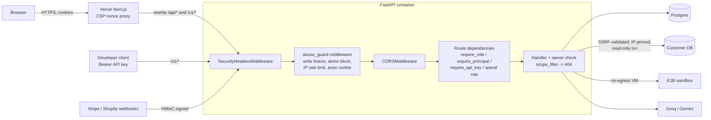

# Security Architecture

Sources: api/index.py, api/utils/ssrf_validator.py, api/utils/connection_url.py, api/utils/sql_validator.py, api/db_service.py, api/utils/pii_masking.py, api/rbac_service.py, api/auth_service.py, api/oauth_service.py, api/utils/caller_scope.py, api/resource_scope_service.py, api/utils/request_guard.py, api/utils/spend_guard.py, api/utils/prompt_guard.py, api/utils/sandbox_policy.py, api/utils/sandbox_paths.py, api/utils/upload_limits.py, api/utils/security_headers.py, security-headers.mjs, src/proxy.ts, api/utils/cors_config.py, api/utils/sentry_setup.py, api/utils/langsmith_pin.py, api/api_key_service.py, api/billing_service.py, api/routes/billing_routes.py, api/routes/connector_routes.py, api/connectors/shopify_connector.py, api/email_verification_service.py, api/utils/envelope_encryption.py, api/audit_service.py, tests/unit/test_route_guards.py, .github/workflows/security.yml

Last verified against code: 2026-11-23

## 1. Trust boundaries and request pipeline

Middleware order: `CORSMiddleware` added first (`api/index.py:56-62`), `abuse_guard` HTTP middleware (`api/index.py:71-131`), then `SecurityHeadersMiddleware` added last so it is outermost and also decorates guard short-circuit responses and preflights (`api/index.py:134-139`).

## 2. Authentication

| Mechanism | Credential | Storage | Source |
|---|---|---|---|
| Browser session | `docbot_session` cookie: `secrets.token_hex(32)`; httpOnly, SameSite=Lax, Secure when `APP_BASE_URL` is https (SAML ACS uses request scheme), max-age `SESSION_TTL_HOURS` (default 8) | `user_sessions.token` = `sha256:` + hex digest | `api/auth_service.py:252-260`, `api/index.py:2633-2641`, `:2795`, `:2973`, `:3031` |
| SAML 2.0 | Signed assertion at `POST /api/auth/saml/acs`; python3-saml settings `strict: True` | JIT-provisioned user | `api/auth_service.py:40-106`, `:176`, `:350` |
| GitHub / Google OAuth | `state` (5 min, single use, in-memory + `oauth_state` cookie scoped to `/api/auth`); Google uses PKCE (`code_challenge`); GitHub requires a verified email | `user_identities (provider, provider_sub)` unique | `api/oauth_service.py:82-230`, `:299-330` |
| Email/password | bcrypt; dummy hash checked on unknown account (timing); strength + breached-password check; per-(email, IP) failure throttle (`LOGIN_FAILURES_PER_WINDOW`, 15 min) | `users.password_hash` | `api/oauth_service.py:241-297`, `api/utils/request_guard.py:125-130`, `:623-650` |
| Email verification | Single-use emailed token, 24 h, SHA-256 at rest; Cloudflare Turnstile on signup when `TURNSTILE_SECRET_KEY` set | `email_verification_tokens` | `api/email_verification_service.py:27-77`, `api/index.py:2874-2925` |
| Developer API key | `Authorization: Bearer dk_live_<token_urlsafe(32)>`; shown once | `api_keys.key_hash` SHA-256, `key_prefix` (16 chars) for display | `api/api_key_service.py:1-92`, `:183`, `:237`, `:363-423` |
| Owner bypass | Raw `OWNER_KEY` accepted only in `X-Owner-Key` header of `POST /api/auth/owner-unlock` (constant-time compare); exchanged for `docbot_owner` cookie holding HMAC-SHA256(OWNER_KEY) | none | `api/utils/request_guard.py:145-151`, `:338-364`, `api/index.py:2696-2728` |
| Anonymous owner | `docbot_anon` cookie, 256-bit random, httpOnly, SameSite=Lax, 30 days | `anon_owner` = SHA-256 digest | `api/utils/caller_scope.py:43-51`, `:70-77`, `:119-146` |

API keys carry scopes `hybrid:read`, `lineage:read` (viewer-equivalent), `autopilot:run`, `connectors:manage` (analyst-equivalent); checked by exact membership, plus a per-key token-bucket rate limit and an `api_key_use` audit event (`api/api_key_service.py:84-89`, `:355-363`, `api/audit_service.py:58`).

## 3. Authorization

### 3.1 Auth mode

`APP_AUTH_MODE=open|required` (default open). `AUTH_REQUIRED=true` is a legacy alias for `required`. An unrecognised value fails closed to `required`. SAML/OAuth env vars alone never enable enforcement (`api/auth_service.py:114-137`).

Boot guards (`api/rbac_service.py:315-355`, called from lifespan `api/index.py:600-602`):
- `MULTI_TENANT=true` without required mode -> refuse to start.
- `ALLOW_ANONYMOUS_SANDBOX` with `MULTI_TENANT` -> refuse; on any deployed env (Railway/ECS/`ENVIRONMENT=prod`) the flag is ignored with a warning (`:253-281`).
- `ALLOWED_ORIGINS` containing `*` with credentialed CORS -> refuse (`api/utils/cors_config.py:32-39`).

### 3.2 RBAC (`api/rbac_service.py`)

Roles: `viewer=1 < analyst=2 < admin=3` (`:44-58`; unknown strings map to analyst). New users default to `analyst` (`api/index.py:233`).

| Dependency | Behaviour | Source |
|---|---|---|
| `require_role(min)` | Skipped in open mode unless `enforce_in_open_mode=True`; else 401 anonymous / 403 below role | `:96-127` |
| `require_admin()` | Logged-in admin in EVERY mode | `:129-142` |
| `require_admin_org_id(user)` | Admin must belong to an org; all admin queries scoped to it | `:144-159` |
| `require_platform_admin()` | Admin AND user id in `PLATFORM_ADMIN_USER_IDS` (cross-org data) | `:161-189` |
| `require_sandbox_user()` | Analyst+ session in every mode for raw code execution (`ALLOW_ANONYMOUS_SANDBOX` dev-only escape) | `:283-305` |
| `require_connector_org` | Analyst+ in every mode, 403 if no org | `api/routes/connector_routes.py:50-59` |
| `require_principal` | Open mode: anon scope. Required mode: logged-in, or anonymous only on a server-created demo session/connection, else 401 | `api/utils/caller_scope.py:274-295` |
| `require_api_key(scope)` | `/v1/*` only | `api/api_key_service.py:363` |

Admin role changes are org-scoped and guard against demoting the last admin (inferred from `update_user_role_in_org`, `api/rbac_service.py:202-250`).

### 3.3 Row ownership (tenant isolation)

`CallerScope(user_id, org_id, anon_token, is_admin)` is derived per request; `scope_filter()` builds the WHERE clause and `owner_values()` stamps INSERTs (`api/utils/caller_scope.py:298-324`). Rules: user rows `user_id=me AND org_id=my org`; org admins see their org's user-owned rows but never anonymous rows (DOCBOT-2317); anonymous callers see only rows with their `anon_owner` digest. Foreign ids return 404 (not 403) to avoid existence disclosure (`:52-54`, `_require_session` `api/index.py:483-508`). `/v1/*` callers are confined to user-owned rows of the key's org (`api/resource_scope_service.py:19-40`, `api/db_service.py:269-284`). Commerce data is reachable only via a `connection_id` whose connector belongs to the caller's org (`api/routes/connector_routes.py:69-75`, `api/commerce_service.py:301-357`). This is application-level scoping; PostgreSQL RLS policies are not used.

### 3.4 Route classification ratchet

`PUBLIC_ROUTES`, `HANDLER_GUARDED`, `DEV_ONLY` and `KNOWN_UNGUARDED` live in `tests/unit/test_route_guards.py:145-202`, not in `api/`. `test_every_route_is_classified` fails on any new unguarded route. Current `KNOWN_UNGUARDED`: `POST /api/edgar/search`, `POST /api/edgar/filings`, `GET /api/edgar/cache` (DOCBOT-1623; the first two are now IP/user rate limited via `edgar_guard`). `DEV_ONLY` routes (`/api/test-persona-switch`, `/api/test-personas`, `/api/auth/debug-urls`) 404 unless `ENV=dev`.

## 4. Outbound connection safety (SSRF)

Two layers in `api/utils/ssrf_validator.py:1-24`:

1. **Syntactic** — `validate_hostname` / `validate_db_identifier` reject `?;=/@{}#&%\"'` and similar, whitespace/control chars, and non-canonical numeric IPv4 forms (`2130706433`, `0x7f.1`) (`:36-58`, `:64-120`).
2. **Resolution** — `resolve_and_validate` resolves with `getaddrinfo` and requires every address to be `is_global` after unwrapping IPv4-mapped / 6to4 / Teredo forms; blocks RFC 1918, loopback, link-local (incl. 169.254.169.254), CGNAT, ULA, multicast, unspecified (`:132-212`). Errors never echo the host or IP.

**DNS pinning** (`api/utils/connection_url.py:1-33`, used by `api/db_service.py:795-902`): URLs are built with `sqlalchemy.engine.URL.create()` (no string interpolation).

| Dialect | Pinning |
|---|---|
| postgresql | hostname kept for TLS SNI; libpq `hostaddr=<validated ip>` so no second DNS lookup |
| mysql | URL host is the validated IP |
| azure_sql | host restricted to Microsoft Azure SQL DNS suffixes; `Encrypt=yes;TrustServerCertificate=no`; ODBC values brace-escaped |
| sqlite | server-generated paths only; user SQLite paths refused at `/api/db/connect` |

Other outbound: Shopify shop domains must match `^[a-z0-9][a-z0-9-]*\.myshopify\.com$` (`api/connectors/shopify_connector.py:50-67`). SEC EDGAR calls go to fixed SEC hosts with a 10 req/s limiter (inferred from `api/connectors/edgar_connector.py`).

## 5. SQL safety — read-only enforcement

| Layer | Mechanism | Source |
|---|---|---|
| 1. Prompt | "Read-only queries ONLY", LIMIT 500 instruction | `api/db_service.py:1961-1963` |
| 2. AST | sqlglot parse; exactly one statement; root must be Select/Union/Intersect/Except; no Insert/Update/Delete/Merge/Create/Drop/Alter/Truncate/Command/Copy/Into node anywhere (catches data-modifying CTEs); rejects MySQL `/*! */` executable comments; non-SQLite dialects execute sqlglot's regenerated SQL (comments stripped) so parser differentials cannot smuggle text; injects `LIMIT 500` | `api/utils/sql_validator.py:17-82`, called `api/db_service.py:2022`, `:2040`, `:2173` |
| 3. Transaction | PostgreSQL `SET TRANSACTION READ ONLY` + `statement_timeout=15000`; MySQL `SET SESSION TRANSACTION READ ONLY`; Azure SQL `SNAPSHOT` isolation only; SQLite none (server-generated local files); `fetchmany(500)`; 15 s asyncio timeout | `api/db_service.py:2052-2110` |

Gap (verified): layer 3 is not a read-only transaction for Azure SQL or SQLite; those rely on layers 1-2.

## 6. Data protection

- **Credentials**: per-org envelope encryption (Fernet DEK per org wrapped by KEK `DB_ENCRYPTION_KEY`), lazy migration of legacy flat-Fernet blobs; see [03-data-model](architecture-03-data-model#5-encryption-at-rest) (`api/utils/envelope_encryption.py`).
- **PII masking** (`api/utils/pii_masking.py:1-33`): regex-only (no LLM), masks emails, US/UK/IN/EU phones, SSNs, Luhn-valid card numbers; financial figures untouched. Applied to SQL result rows when `db_connections.pii_masking_enabled` (`api/db_service.py:1632-1639`), streamed answers via `StreamingPIIMasker` (`api/db_service.py:2219`, `api/hybrid_service.py:864`), sandbox output (`api/index.py:2240`), chat (`api/index.py:1442`), autopilot (`api/autopilot_service.py:2185`, `:2482`) and audit details (`api/audit_service.py:138`).
- **Prompt injection** (`api/utils/prompt_guard.py:1-48`): retrieved document text wrapped in `<untrusted_document_content>` tags, heuristic scan flags (never drops) suspicious chunks, shared `PROMPT_INJECTION_DEFENSE_NOTICE` in system prompts. Used in `/api/chat` (`api/index.py:1372`), hybrid (`api/hybrid_service.py:385`, `:774`, `:819`), autopilot (`api/autopilot_service.py:955`, `:1792`, `:2050`). Documented as defense-in-depth only.
- **Telemetry hygiene**: Sentry errors-only (`traces_sample_rate=0.0`, `send_default_pii=False`) with `before_send`/`before_breadcrumb` scrubbing of URL credentials, `password|secret|token|api_key|authorization|cookie|owner_key` keys and provider key patterns (Groq, Stripe, OpenAI-style, Google, E2B) (`api/utils/sentry_setup.py:1-105`). LangChain/LangSmith auto-tracing is pinned OFF before any import (`api/index.py:6-9`, `api/utils/langsmith_pin.py:1-30`). `llm_calls` stores metadata only, sanitized errors (`api/llm_trace_service.py:93`).

## 7. Sandbox isolation (E2B)

`api/utils/sandbox_policy.py:1-52`: every sandbox is created through `create_sandbox` with a server-side `timeout` (60 s for raw user code; exec timeout + 90 s install budget for internal codegen), `allow_internet_access=False` by default. Raw user code (`POST /api/sandbox/execute`) never gets egress; internal LLM-codegen paths get egress only for a non-prebaked package import or a `ModuleNotFoundError` retry, and only if `SANDBOX_PIP_INTERNET` is not disabled. Optional `E2B_SANDBOX_TEMPLATE`. Each VM is single-use. CSV file names inside the VM are reduced to `[A-Za-z0-9_.-]` under `/tmp` to prevent traversal or string-literal breakout (`api/utils/sandbox_paths.py:16-35`). Sandbox runs are metered per org/user (`SANDBOX_RUNS_PER_HOUR`, default 60) never per client-supplied session id (`api/utils/request_guard.py:51-55`).

## 8. Abuse and cost controls

`abuse_guard` middleware (`api/index.py:71-131`) and `api/utils/request_guard.py`:

| Control | Env (default) | Scope | Source |
|---|---|---|---|
| Write freeze | `WRITE_FREEZE` (off) | 503 on non-GET `/api/*`, `/v1/*`, owner included | `:104`, `:366-368` |
| Public demo blocking | `PUBLIC_DEMO_MODE` (off) | 403 on `/api/upload`, `/api/db/connect`, `/api/db/upload`, `/api/connectors/register`, `/api/edgar/ingest` | `:100`, `:153-161` |
| IP rate limit | `RATE_LIMIT_PER_MIN` (60) | POST/DELETE `/api/*`, `/v1/*`; `/api/billing/webhook` exempt | `:105`, `:382-396` |
| Session budget | `SESSION_BUDGET` (100 / 7 d) | weighted: chat 1, hybrid 2, sandbox 2, autopilot 5 | `:107-108`, `:163-169` |
| User daily budget | `USER_DAILY_BUDGET` (500 / UTC day) | signed-in users | `:141-143` |
| Demo init | `DEMO_INIT_PER_IP_PER_HOUR` 10, `_PER_USER_` 10, `_GLOBAL_` 300 | `POST /api/demo/init` | `:111-114`, `:478-500` |
| Demo spend breaker | `DEMO_DAILY_USD_CAP` (10) | 429 on demo routes | `:442-476` |
| EDGAR | `EDGAR_PER_IP_PER_HOUR` 60, `EDGAR_PER_USER_PER_HOUR` 120, `EDGAR_BATCH_MAX` 5 | EDGAR routes | `:118-120`, `:504-530` |
| Upload gate | `GATE_UPLOADS` (off) | 401 for anonymous uploads / live DB | `:140`, `api/index.py:442-458` |
| Platform spend cap | `PLATFORM_DAILY_USD_CAP` (25) | 503 for free-tier callers once daily LLM + sandbox spend is reached; paid orgs and owner continue | `api/utils/spend_guard.py:1-14` |
| Upload limits | `UPLOAD_MAX_FILE_MB` 25, `UPLOAD_MAX_FILES` 10, `UPLOAD_PDF_MAX_PAGES` 500, PDF parse timeout 60 s, SQLite 100 MB, CSV 50 MB; streamed to `mkstemp` with 413 on overflow; PDF magic check | `api/utils/upload_limits.py:1-34` |

Counters are durable in `rate_limit_counters` and shared across containers; guards fail OPEN on counter-store errors (`api/utils/request_guard.py:12-20`). Client IP is taken from the right-most trusted `X-Forwarded-For` hop (`TRUSTED_PROXY_HOPS`, default 1), never the client-controlled left-most entry (`:319-336`). The owner cookie bypasses all of the above except write freeze.

## 9. Webhooks

| Webhook | Verification | Source |
|---|---|---|
| `POST /api/billing/webhook` (Stripe) | Parses `Stripe-Signature` `t=..,v1=..`, HMAC-SHA256 over `"{t}.{payload}"` with `STRIPE_WEBHOOK_SECRET`, `hmac.compare_digest`; 400 on mismatch, 503 when secret unset; exempt from IP limiter | `api/billing_service.py:190-216`, `api/routes/billing_routes.py:60-70` |
| `POST /api/marketplace/webhook/shopify` | `X-Shopify-Hmac-SHA256` over raw body with the connector's webhook secret, constant-time compare; shop domain header validated against `*.myshopify.com` | `api/routes/connector_routes.py:345-375`, `api/connectors/shopify_connector.py:118-125` |

## 10. HTTP headers, CSP and CORS

**Backend** (`api/utils/security_headers.py`): pure ASGI middleware (does not buffer SSE). Every response: HSTS `max-age=31536000; includeSubDomains`, `X-Frame-Options: DENY`, `nosniff`, `Referrer-Policy: strict-origin-when-cross-origin`, restrictive `Permissions-Policy`; CSP `default-src 'none'; frame-ancestors 'none'; base-uri 'none'; form-action 'none'` except on `/docs`, `/redoc`. Route-set headers are never overwritten.

**Frontend**: static headers (HSTS, XFO, nosniff, referrer, permissions) from `security-headers.mjs` via `next.config.ts`; per-request CSP from `src/proxy.ts` with a random nonce and `'strict-dynamic'` (no `'unsafe-inline'` scripts; `'unsafe-eval'` dev only). Allowed: Vercel Analytics/Insights, Cloudflare Turnstile (script + frame), MSAL login endpoint (connect + frame), backend origin in `connect-src`, `img-src data: blob:` for E2B charts, `frame-ancestors 'none'`, `object-src 'none'`. Vercel Live origins only on preview deploys. Proxy matcher skips `/api/`, `/v1/`, static assets and prefetches (`security-headers.mjs:1-137`, `src/proxy.ts:1-31`).

**CORS** (`api/index.py:52-62`, `api/utils/cors_config.py`): origins from `ALLOWED_ORIGINS` (default `http://localhost:3000`), trimmed of whitespace and trailing slashes; credentials allowed; methods GET/POST/DELETE; headers `Content-Type` only. In production the browser reaches the API same-origin through the Vercel rewrite, so CORS mainly matters for direct calls (inferred from `next.config.ts` rewrites).

## 11. Secrets handling

- All secrets come from env vars; `DATABASE_URL` absence exits at import (`api/index.py:147-152`); `DB_ENCRYPTION_KEY` absence raises on first use (`api/utils/encryption.py:8-12`).
- Credentials, API keys and session tokens are never logged (API key service logs only id/prefix, `api/api_key_service.py:33-36`); SSRF errors omit host/IP (`api/utils/ssrf_validator.py:22`).
- Raw `OWNER_KEY` only enters via one header; cookies hold an HMAC.
- `key_source` (`platform|byok`) is recorded in `llm_calls`/`usage_events`; the key itself is never persisted (`api/llm_trace_service.py:94-98`).

## 12. Audit logging

Append-only `audit_log` with a PostgreSQL trigger blocking UPDATE/DELETE (`api/audit_service.py:162-207`). Events: query, db_connect, db_disconnect, upload, login, logout, api_key_use. Admin export via `GET /admin/audit-log` (JSON/CSV, admin-only, org-scoped). Writes are best-effort background tasks. The per-org hash chain (DOCBOT-2501) is NOT merged to `main`; it exists only on branch `feature/DOCBOT-2501-audit-hash-chain`.

## 13. CI security gates (`.github/workflows/security.yml`)

Runs on every push, PRs to `main`, and weekly (Mon 06:17 UTC); `permissions: contents: read`.

| Job | Tool | Blocking |
|---|---|---|
| bandit | `bandit -r api -ll` (medium+) | yes |
| pip-audit | `pip-audit -r requirements.txt` with 4 pinned ignores | yes |
| npm-audit | `npm audit --audit-level=high` | no (`continue-on-error`, known baseline) |
| gitleaks | full-history scan, checksum-verified binary, `.github/gitleaks.toml`, `--redact` | yes |

## 14. Known gaps (from code comments)

| Gap | Source |
|---|---|
| Chroma vector store is plaintext on disk; volume at-rest encryption unverified | `api/utils/vector_store.py:28-48` |
| KEK is a single env secret; no KMS | `api/utils/envelope_encryption.py:68-78` |
| Prompt-injection guard is heuristic | `api/utils/prompt_guard.py:25-35` |
| Azure SQL / SQLite lack transaction-level read-only | `api/db_service.py:2086-2093` |
| EDGAR routes in `KNOWN_UNGUARDED` | `tests/unit/test_route_guards.py:196-202` |
| Abuse guards fail open on counter-store outage | `api/utils/request_guard.py:18-19` |
| OAuth state store is in-memory (single instance) | `api/oauth_service.py:299-307` |
| Audit IP uses left-most `X-Forwarded-For` (spoofable) unlike `request_guard.client_ip` | `api/audit_service.py:30-46` |
| Audit hash chain unmerged | branch `feature/DOCBOT-2501-audit-hash-chain` |
| `/v1/connectors*` not org-scoped: list returns every org's connectors, register saves without `org_id`, sync has no org check (the `/api/connectors*` copies were fixed in DOCBOT-1602). Cross-tenant; fix before any public API launch | `api/index.py:3905-3975`; see [Current API state](api-01-current-state) |
