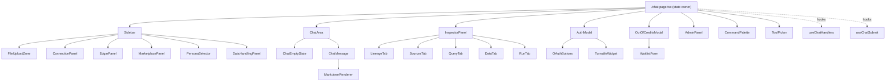
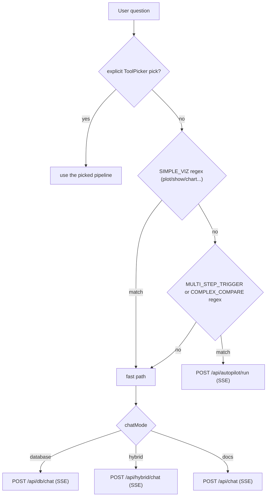

# Frontend Architecture

Sources: `src/app/**`, `src/components/**`, `src/hooks/useChatHandlers.ts`, `src/hooks/useChatSubmit.ts`, `src/lib/**`, `src/lib/schemas/*.ts`, `src/store/uiStore.ts`, `src/proxy.ts`, `src/instrumentation-client.ts`, `next.config.ts`, `security-headers.mjs`, `package.json`, `api/index.py`, `api/routes/*.py`, `api/*_models.py`

Last verified against code: 2026-11-23

## 1. Stack

| Concern | Choice | Evidence |
|---------|--------|----------|
| Framework | Next.js 16.4 (App Router), React 19.3 | `package.json` |
| Styling | TailwindCSS 4 + CSS variables in `src/app/globals.css` | `postcss.config.mjs`, `globals.css` |
| UI primitives | Radix (dialog, popover, tabs, tooltip) wrapped in `src/components/ui/*`, `react-resizable-panels`, `cmdk` (command palette), `lucide-react` | `package.json`, `src/components/ui/index.ts` |
| Markdown / math / code | `react-markdown`, `remark-gfm`, `remark-math`, `rehype-katex`, `katex`, `prism-react-renderer` | `src/components/MarkdownRenderer.tsx` |
| Tables | `@tanstack/react-table` | `package.json` |
| Runtime validation | Zod v4, `z.config({ jitless: true })` so Zod never probes `new Function` under the nonce CSP | `src/instrumentation-client.ts` |
| Cross-component UI state | Zustand with `persist` (localStorage key `docbot-ui-store`) | `src/store/uiStore.ts:1-2,24-30` |
| Azure SQL Entra sign-in | `@azure/msal-browser` | `src/components/ConnectionPanel.tsx:290` |
| Analytics | `@vercel/analytics` | `src/app/layout.tsx:3,68` |
| Bot check | Cloudflare Turnstile widget | `src/components/TurnstileWidget.tsx` |

There are no Next.js API routes (`src/app/api/` does not exist). All data calls are same-origin `fetch` to `/api/*` (and `/v1/*` for API-key clients), which `next.config.ts:41-47` rewrites to the FastAPI backend (`BACKEND_URL`).

## 2. Routes and pages

| Route | File | Lines | Purpose |
|-------|------|-------|---------|
| `/` | `src/app/page.tsx` | 830 | Marketing landing page; embeds `WaitlistForm` |
| `/landing` | `next.config.ts:36-38` | n/a | Permanent redirect to `/` (DOCBOT-2537) |
| `/chat` | `src/app/chat/page.tsx` | 894 | The application shell: Sidebar, ChatArea, InspectorPanel, modals |
| `/signup` | `src/app/signup/page.tsx` | 298 | Standalone signup (form + sample tie-out), OAuth buttons, Turnstile (DOCBOT-1712) |
| `/onboarding` | `src/app/onboarding/page.tsx` | 179 | Two-question post-signup setup, skippable (DOCBOT-1712) |
| `/verify` | `src/app/verify/page.tsx` | 99 | Email link landing (`/verify?token=...`) |
| `/privacy`, `/terms` | `src/app/privacy/page.tsx`, `src/app/terms/page.tsx` | 108, 100 | Draft legal pages via `LegalPage` shell (DOCBOT-1707) |
| `robots.txt` | `src/app/robots.ts` | 9 | Disallows `/chat`, `/api/`, `/onboarding`, `/verify` |
| `sitemap.xml` | `src/app/sitemap.ts` | 7 | Sitemap |

Root layout (`src/app/layout.tsx`) sets metadata from `SITE_URL` (`src/lib/site.ts`), calls `await connection()` (line 61) to force dynamic rendering so each response gets a fresh CSP nonce, and mounts `<Analytics />`.

### 2.1 Edge proxy and CSP

`src/proxy.ts` (Next 16 "proxy", the former middleware) runs on every page request except `api/`, `v1/`, `_next/static`, `_next/image`, `favicon.ico`, and prefetches. It mints a base64 nonce from `crypto.randomUUID()`, builds the policy with `buildCsp()` from `security-headers.mjs`, and sets `Content-Security-Policy` on both the forwarded request (so Next stamps its inline scripts with the nonce) and the response (DOCBOT-2337).

CSP summary (`security-headers.mjs` header comment): `script-src` nonce + `'strict-dynamic'`, no `'unsafe-inline'`, `'unsafe-eval'` dev only; `style-src 'unsafe-inline'` (React style props, KaTeX); `img-src data: blob:` (E2B charts as base64, export object URLs); `connect-src` self + backend origin + Vercel analytics + MSAL login; Turnstile in `script-src`/`frame-src`; `vercel.live` origins only when `VERCEL_ENV=preview`. Static headers from `securityHeaders()` (HSTS `max-age=31536000; includeSubDomains`, framing, nosniff, referrer, `Permissions-Policy` disabling camera/mic/geo/payment/usb/topics) are applied to `/:path*` in `next.config.ts:24-33`.

## 3. Component map

| Component | Lines | Role |
|-----------|-------|------|
| `Sidebar.tsx` | 547 | Tabbed sidebar (Sources / Tools / Settings) hosting upload, connection, EDGAR, marketplace panels |
| `ChatArea.tsx` | 708 | Message list, input, persona dropdown, empty-state onboarding, demo buttons |
| `ChatMessage.tsx` | 509 | One message: markdown, charts, SQL/code cards, citations, autopilot steps, thumbs feedback |
| `InspectorPanel.tsx` + `inspector/*` | 88 + 845 | Right panel tabs `lineage`, `sources`, `query`, `data`, `run` (`uiStore.ts` `INSPECTOR_TABS`); `LineageTab` renders tie-out cards and xlsx/pdf download links |
| `AdminPanel.tsx` | 824 | Users/roles, audit log with filters, usage metrics, API keys |
| `ConnectionPanel.tsx` | 393 | Live DB form, Azure SQL Entra via MSAL, schema view, query history |
| `EdgarPanel.tsx` | 423 | SEC search, filing list, single and batch ingest |
| `MarketplacePanel.tsx` | 341 | Register/sync/disconnect commerce connectors, "last synced" badge |
| `FileUploadZone.tsx` | 214 | Unified upload routing: PDF → `/api/upload`, CSV → `/api/db/upload/csv`, SQLite → `/api/db/upload` |
| `CommandPalette.tsx` | 287 | Cmd+K palette (cmdk) |
| `ToolPicker.tsx` | 214 | Fetches and Zod-validates `/api/tools` (DOCBOT-1514); a pick can force a pipeline / autopilot |
| `AuthModal.tsx`, `OAuthButtons.tsx`, `TurnstileWidget.tsx` | 176, 66, 106 | Login/register, GitHub/Google, SAML link, Turnstile on register |
| `OutOfCreditsModal.tsx`, `WaitlistForm.tsx` | 181, 119 | Paywall on HTTP 402 (packs + Stripe checkout) and waitlist fallback (DOCBOT-1805, 2581) |
| `personas.tsx`, `PersonaSelector.tsx` | 172, 119 | Frontend persona registry mirroring `api/personas.py` keys |
| `MarkdownRenderer.tsx` | 292 | Markdown + GFM + KaTeX + Prism, tie-out marker links |
| `ui/*` | 548 | Button, Card, Badge, Dialog, Input, Panel, Popover, Tabs, Tooltip wrappers |
| `types.ts` | 387 | Shared TS types and most response Zod schemas |

## 4. State management

Three layers:

1. **Page-local React state in `src/app/chat/page.tsx`**: about 70 `useState` hooks (lines 117-277) owning messages, input, loading, `sessionId` (PDF vector-store session), `connectionId` / `isCsvConnection` (DB or CSV source), `chatMode` (`docs` | `database` | `hybrid`), persona and auto-routing flag, autopilot run state (`autopilotSteps`, `autopilotPlan`), auth (`authUser`, `authConfig`, modal form fields, Turnstile token), workspace connections, marketplace connectors, admin panel data, toasts, paywall. An `anonymousSessionId` is minted once with `crypto.randomUUID()` (`src/lib/chatSession.ts:22-26`).
2. **Hooks that receive that state**: `useChatHandlers` (853 lines: upload, DB connect/schema/history, auth, admin, export, connectors) and `useChatSubmit` (758 lines: chat routing and SSE parsing). The page passes setters in, so the hooks hold no state of their own.
3. **Zustand `useUIStore`** (`src/store/uiStore.ts`): sidebar/inspector visibility, inspector tab, selected artifact, `selectedLineage`, `focusSourceId`. Persisted to localStorage via `persist` with a `partialize` allowlist (lines 24-30). Used by 13 components and both hooks.

Chat mode resolution (`src/lib/chatSession.ts:10-19`): doc session and connection both present → `hybrid`; `database` without a connection → `docs`; `hybrid` that lost a source falls back to the remaining one. `page.tsx` re-resolves when `sessionId` or `connectionId` change.

### 4.1 Submit routing (`src/hooks/useChatSubmit.ts`)

Regexes are at `useChatSubmit.ts:241-243`; auto-trigger only applies when a session or connection exists and shows an "Autopilot activated" toast. The autopilot request retries once on a network error or 502/503/504 before any bytes stream (cold backend), but not on 402/429 (`useChatSubmit.ts:276-290`).

Every path sends `history` = the last 6 non-empty messages as `{role, content}`, with inline base64 images replaced by `[chart]` and each message capped at 4000 chars (`src/lib/chatStream.ts:25-46`). Charts and citations never leave the browser.

### 4.2 SSE event types consumed

The backend streams `text/event-stream` lines of `data: {json}`; the hook parses each line and dispatches on `type`.

| Endpoint | Event `type` values handled | Lines |
|----------|-----------------------------|-------|
| `/api/autopilot/run` | `documents_expired`, `plan`, `step` (validated by `AutopilotStepEventSchema`), `lineage`, `answer`, `done`, `warning`, `error` | `useChatSubmit.ts:337-411` |
| `/api/db/chat` | `token`, `lineage`, `metadata`, `analysis_code`, `chart`, `error` | `useChatSubmit.ts:497-525` |
| `/api/hybrid/chat` | `documents_expired`, `token`, `replace`, `lineage`, `metadata`, `done`, `analysis_code`, `chart`, `error` | `useChatSubmit.ts:591-643` |
| `/api/chat` | `documents_expired`, `token`, `citations`, `lineage`, `error` | `useChatSubmit.ts:715-733` |

An `error` event is thrown as `StreamErrorEvent` so the per-line parse `try/catch` does not swallow it; a stream that ends with no tokens fills the bubble with `EMPTY_ANSWER_MESSAGE` (`src/lib/chatStream.ts:3-23`, DOCBOT-2303).

### 4.3 Refused-response handling (`src/lib/httpGate.ts`)

One classifier for every non-OK response (DOCBOT-2305):

| Kind | Trigger | UI |
|------|---------|----|
| `signin` | 401; 403 whose detail mentions sign in / verify email; 403 `email_unverified` quota payload; 429 "sign in (free)" | Opens `AuthModal` |
| `rate` | Other 429 | Toast with backend `detail` |
| `credits` | 402 with structured `QuotaErrorPayload` | `OutOfCreditsModal` |
| `capacity` | 503 `{detail:{error:"platform_capacity"}}` | Sticky toast, never retried |
| `other` | Everything else | Caller's own error |

`page.tsx` registers the single listener with `onHttpGate` (line 25 import). Helpers: `ensureOk()` throws `HttpGateError` after reporting, `gateResponse()` returns true when a gate was shown.

## 5. Zod schemas and backend mirrors

| Zod module | Schemas | Backend source of truth | Drift guard |
|------------|---------|-------------------------|-------------|
| `src/lib/schemas/billing.ts` | `CreditBalance`, `CreditPack`, `CreditPackCatalog`, `CheckoutSessionRequest/Response`, `LedgerEntry`, usage, `QuotaErrorPayload`, enums (`LedgerEntryKind`, `UsageEventKind`, `KeySource`, `QuotaErrorCode`) | `api/billing_models.py:81-414` | `tests/unit/test_billing_models.py` fails if a Pydantic field is missing (comment at `billing.ts:3-4`) |
| `src/lib/schemas/emailVerify.ts` | `RegisterRequest/Response`, `VerifyRequest/Response` | `api/email_verify_models.py:17-23`, `RegisterRequest` in `api/index.py` | field-for-field comment |
| `src/lib/schemas/waitlist.ts` | `WaitlistSource`, `WaitlistRequest/Response`, `WaitlistEntry`, `WaitlistList` | `api/waitlist_models.py:19-53` | field-for-field comment |
| `src/lib/schemas/signup.ts` | `AuthConfig`, `OAuthStart`, `ApiError`, `OnboardingRequest/Response`, `USE_CASE_OPTIONS` | `GET /api/auth/config` (`api/index.py:2679`), `api/routes/onboarding_routes.py` | comment |
| `src/lib/schemas/ownerUnlock.ts` | `OwnerUnlockResponse` | `OwnerUnlockResponse` in `api/index.py` (route at 2696) | comment |
| `src/lib/schemas/tieout.ts` | `TieOutCard`, citations, severity/unit enums, `TIE_OUT_MARKER_RE` | `api/utils/lineage.py::LineageDiscrepancy` | comment |
| `src/lib/schemas/autopilotStep.ts` | `AutopilotStepEvent` | step events yielded by `api/autopilot_service.py` | comment |
| `src/components/types.ts` | `AuthMe`, `AdminUser(s)`, `AuditEvent`, `AuditLogResponse`, `AdminMetrics` (+ LLM cost/cache), `ApiKey*`, `Workspace*`, `DbSchemaResponse`, `Lineage*`, `DocumentsExpiredEvent`, `TraceFeedbackResponse`, `ConnectorInfo/List/Sync`, `ToolInfo`, `ToolsResponse` | ad-hoc dict responses in `api/index.py`, `api/routes/connector_routes.py` models, `api/metrics_service.py` | none (inferred) |

Backend `api/session_models.py` (`SessionListResponse` etc.) has no Zod mirror because the frontend never calls the session endpoints (section 6.2).

## 6. Frontend → backend call map

Produced by `grep -rnE "fetch\(|['\"\`]/(api|v1|admin)/" src`. Backend line numbers come from an AST scan of route decorators in `api/index.py` and `api/routes/*_routes.py`.

### 6.1 Calls made

| Frontend call site | Method + path | Backend handler |
|--------------------|---------------|-----------------|
| `src/app/chat/page.tsx:310` | POST `/api/auth/owner-unlock` | `api/index.py:2696` `owner_unlock` |
| `src/app/chat/page.tsx:429`, `src/app/signup/page.tsx:41` | GET `/api/auth/config` | `api/index.py:2679` `auth_config` |
| `src/app/chat/page.tsx:436,488`, `src/app/onboarding/page.tsx:35`, `src/hooks/useChatHandlers.ts:436` | GET `/api/auth/me` | `api/index.py:3036` `auth_me` |
| `src/app/chat/page.tsx:456`, `src/app/verify/page.tsx:35` | POST `/api/auth/verify` | `api/routes/email_verify_routes.py:47` `verify_email` |
| `src/app/chat/page.tsx:604` | POST `/api/demo/init?dataset=` | `api/index.py:969` `init_demo` |
| `src/app/signup/page.tsx:78`, `src/hooks/useChatHandlers.ts:410` | POST `/api/auth/register` | `api/index.py:2896` `auth_register` |
| `src/app/signup/page.tsx:112`, `src/app/onboarding/page.tsx:45`, `src/hooks/useChatHandlers.ts:410` | POST `/api/auth/login` | `api/index.py:2978` `auth_login` |
| `src/app/onboarding/page.tsx:77` | POST `/api/auth/onboarding` | `api/routes/onboarding_routes.py:48` `save_onboarding` |
| `src/components/OAuthButtons.tsx:27` | GET `/api/auth/github` or `/api/auth/google` | `api/index.py:2729` `github_login`, `api/index.py:2800` `google_login` |
| `src/components/AuthModal.tsx:165` (link) | GET `/api/auth/saml/login` | `api/index.py:2566` `saml_login` |
| `src/hooks/useChatHandlers.ts:350` | GET `/api/auth/workspace` | `api/index.py:3082` `get_workspace` |
| `src/hooks/useChatHandlers.ts:364` | POST `/api/auth/logout` | `api/index.py:3055` `auth_logout` |
| `src/components/OutOfCreditsModal.tsx:49` | GET `/api/billing/packs` | `api/routes/billing_routes.py:40` `list_packs` |
| `src/components/OutOfCreditsModal.tsx:62` | POST `/api/billing/checkout` | `api/routes/billing_routes.py:45` `create_checkout` |
| `src/components/WaitlistForm.tsx:51` | POST `/api/waitlist` | `api/routes/waitlist_routes.py:33` `join_waitlist` |
| `src/components/ToolPicker.tsx:55` | GET `/api/tools` | `api/index.py:943` `get_tools` |
| `src/hooks/useChatHandlers.ts:649` | POST `/api/upload` | `api/index.py:992` `upload_documents` |
| `src/hooks/useChatHandlers.ts:743` | GET `/api/export/{session_id}?format=` | `api/index.py:1616` `export_session` |
| `src/hooks/useChatSubmit.ts:683` | POST `/api/chat` (SSE) | `api/index.py:1202` `chat` |
| `src/hooks/useChatSubmit.ts:454` | POST `/api/db/chat` (SSE) | `api/index.py:1964` `db_chat` |
| `src/hooks/useChatSubmit.ts:557` | POST `/api/hybrid/chat` (SSE) | `api/index.py:2349` `hybrid_chat_route` |
| `src/hooks/useChatSubmit.ts:282` | POST `/api/autopilot/run` (SSE) | `api/index.py:2437` `autopilot_run` |
| `src/hooks/useChatHandlers.ts:293` | POST `/api/db/connect` | `api/index.py:1796` `db_connect` |
| `src/hooks/useChatHandlers.ts:247` | POST `/api/db/upload` | `api/index.py:2098` `db_upload_sqlite` |
| `src/hooks/useChatHandlers.ts:247` | POST `/api/db/upload/csv` | `api/index.py:2135` `db_upload_csv` |
| `src/hooks/useChatHandlers.ts:188` | GET `/api/db/schema/{connection_id}` | `api/index.py:1892` `db_schema` |
| `src/hooks/useChatHandlers.ts:201` | POST `/api/db/refresh-schema/{connection_id}` | `api/index.py:1927` `db_refresh_schema` |
| `src/hooks/useChatHandlers.ts:174` | GET `/api/db/history/{connection_id}?limit=20` | `api/index.py:2061` `db_query_history` |
| `src/components/EdgarPanel.tsx:73` | POST `/api/edgar/search` | `api/index.py:3485` `edgar_search` |
| `src/components/EdgarPanel.tsx:99,120` | POST `/api/edgar/filings` | `api/index.py:3495` `edgar_list_filings` |
| `src/components/EdgarPanel.tsx:141` | POST `/api/edgar/ingest` | `api/index.py:3505` `edgar_ingest_filing` |
| `src/components/EdgarPanel.tsx:177` | POST `/api/edgar/ingest-batch` | `api/index.py:3532` `edgar_ingest_batch` |
| `src/components/ChatMessage.tsx:290` | POST `/api/traces/{trace_id}/feedback` | `api/index.py:2320` `submit_trace_feedback` |
| `src/components/inspector/RunTab.tsx:20` | GET `/api/lineage/{run_id}` | `api/index.py:2296` `get_answer_lineage` |
| `src/components/inspector/LineageTab.tsx:305` (link) | GET `/api/lineage/{run_id}/tieout.{xlsx,pdf}` | `api/routes/tieout_routes.py:37` `download_tieout` |
| `src/hooks/useChatHandlers.ts:772` | GET `/api/connectors` | `api/routes/connector_routes.py:200` `list_connectors` |
| `src/hooks/useChatHandlers.ts:783` | POST `/api/connectors/register` | `api/routes/connector_routes.py:162` `register_connector` |
| `src/hooks/useChatHandlers.ts:795` | POST `/api/connectors/{id}/sync` | `api/routes/connector_routes.py:268` `sync_connector` |
| `src/hooks/useChatHandlers.ts:812` | DELETE `/api/connectors/{id}` | `api/routes/connector_routes.py:216` `disconnect_connector` |
| `src/hooks/useChatHandlers.ts:460` | GET `/admin/users` | `api/index.py:3255` `list_users` |
| `src/hooks/useChatHandlers.ts:517` | PATCH `/admin/users/{user_id}/role` | `api/index.py:3289` `update_user_role` |
| `src/hooks/useChatHandlers.ts:478` | GET `/admin/metrics` | `api/index.py:3366` `get_admin_metrics` |
| `src/hooks/useChatHandlers.ts:503,603` | GET `/admin/audit-log?...` | `api/index.py:3152` `get_audit_log` |
| `src/hooks/useChatHandlers.ts:540` | GET `/admin/api-keys` | `api/index.py:3323` `list_admin_api_keys` |
| `src/hooks/useChatHandlers.ts:555` | POST `/admin/api-keys` | `api/index.py:3335` `create_admin_api_key` |
| `src/hooks/useChatHandlers.ts:581` | DELETE `/admin/api-keys/{key_id}` | `api/index.py:3351` `revoke_admin_api_key` |

OAuth callbacks (`/api/auth/github/callback`, `/api/auth/google/callback`) and `/api/auth/saml/acs` are browser redirect / IdP POST targets, not `fetch` calls.

### 6.2 Backend endpoints with no frontend caller

`GET /api/health`, `GET /api/personas`, `GET /api/sessions`, `GET|DELETE /api/session/{id}`, `POST /api/session/{id}/update-persona`, `POST /api/test-persona-switch`, `GET /api/test-personas`, `DELETE /api/db/disconnect/{id}`, `GET /api/db/sessions`, `POST /api/sandbox/execute`, `GET /api/artifacts/{session_id}`, `GET /api/artifacts/item/{id}`, `GET /api/edgar/cache`, `GET /api/connectors/types`, `POST /api/connectors/{id}/orders|financials`, `GET /api/commerce/{id}/orders|financials`, `POST /api/marketplace/webhook/shopify` (Shopify), Stripe webhook (Stripe), `GET /api/auth/saml/metadata`, `GET /api/auth/debug-urls`, `GET /admin/funnel`, `POST /admin/credits/grant`, `GET /api/admin/waitlist`, and all `/v1/*` (API-key clients, see `docs/wiki/api/`).

## 7. Known gaps (from code)

- **`/admin/*` is not proxied.** The admin panel fetches `/admin/users`, `/admin/metrics`, `/admin/audit-log`, `/admin/api-keys` same-origin (`src/hooks/useChatHandlers.ts:460-603`), but `next.config.ts:44-47` rewrites only `/api/*` and `/v1/*`, and there is no `src/app/admin` route. On the Vercel origin these calls should 404 (inferred, not checked against production). Fix options: add `"admin"` to the rewrite prefixes or move admin routes under `/api/admin/` (as `GET /api/admin/waitlist` already is).
- Response Zod coverage is partial: chat SSE events other than autopilot `step` are parsed as untyped JSON in `useChatSubmit.ts`.
- `page.tsx` is 894 lines with about 70 `useState` hooks; most domain state is page-local and threaded through two large hooks rather than stored in Zustand.
- No frontend test runner; CI runs `tsc --noEmit` and ESLint only (`.github/workflows/ci.yml`).

## 8. Doc drift vs CLAUDE.md

| CLAUDE.md says | Code says |
|----------------|-----------|
| `src/app/chat/page.tsx` ~512 lines | 894 lines |
| Next.js proxies `/api/*` | Proxies `/api/*` and `/v1/*` (`next.config.ts:44`); backend URL var is `BACKEND_URL`, `RAILWAY_BACKEND_URL` is legacy |
| Landing at `/` and `/landing` | `/landing` 301-redirects to `/` |
| Components list | Also `InspectorPanel` + `inspector/*`, `OutOfCreditsModal`, `WaitlistForm`, `TurnstileWidget`, `OAuthButtons`, `ToolPicker`, `DataHandlingPanel`, `LegalPage`, `MarkdownRenderer`, `ui/*`; Zustand store in `src/store/` |
| Pages: `/` and `/chat` | Also `/signup`, `/onboarding`, `/verify`, `/privacy`, `/terms` |
